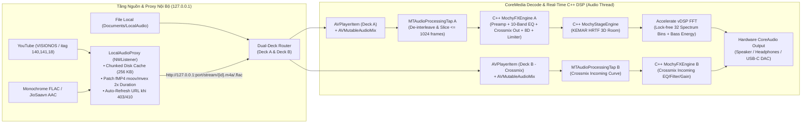

# NATCH MUSIC (iOS) — BÁO CÁO KIỂM TOÁN KIẾN TRÚC TOÀN DIỆN & ĐẶC TẢ SỬA LỖI CHO NEON

> **Vai trò kiểm toán:** Principal iOS Audio & Architecture Auditor  
> **Dự án kiểm toán:** `natch-music-ios` (`commit 066eb8b` / tag `v1.0.0`)  
> **Chuẩn UI/UX & Tính năng duy nhất (1:1 Reference):** [`realidkroo/Mochy-Music`](https://github.com/realidkroo/Mochy-Music) (`v8.5.0.0 build#1308`, Schema `v47`, GPL-3.0)  
> **Nguồn tham khảo kỹ thuật xử lý lỗi iOS thực chiến (CHỈ tầng Audio/Proxy/InnerTube/Import):** [`concas2025/Lemielmusic`](https://github.com/concas2025/Lemielmusic) (`local_audio_proxy_io.dart`, `ytm_service.dart`, `player_controller.dart`, `import_service.dart`)  
> **Quy tắc bất biến cho Neon:** Giữ 100% tinh thần thiết kế, bố cục, chuyển động và triết lý GPL-3.0 không paywall/không quảng cáo của **Mochy Music**. **TUYỆT ĐỐI KHÔNG** mang giao diện Liquid Glass hay bố cục riêng của `Lemielmusic` sang Natch Music.

---

## 1. Tổng Quan Hiện Trạng & Ma Trận Mức Độ Nghiêm Trọng (P0 / P1 / P2)

### 1.1. Đánh giá trung thực hiện trạng bản `v1.0.0`
Bản build `v1.0.0` hiện tại biên dịch thành công trên Xcode 16 (`macos-15`), vượt qua 8 gói unit test (`swift test --package-path Packages`) và đóng gói được file `.ipa` nhờ bộ khung Swift Package tách lớp tốt (`MochyCore`, `MochyDatabase` đủ 25 bảng + 3 views v47, `MochyInnerTube`, `MochyModules`, `MochyDSP`, `MochyLyrics`, `MochyAudio`, `MochySync`, `MochyUI`).

Tuy nhiên, khi soi sâu từng dòng code dưới góc độ **iOS CoreAudio / CoreMedia thực tế** và đối chiếu trực tiếp với mã nguồn Kotlin gốc của `realidkroo/Mochy-Music`, dự án đang mắc **4 nhóm lỗi kiến trúc nghiêm trọng** khiến trải nghiệm trên iPhone thật bị hỏng hoặc chỉ dừng ở mức bản dựng khung (scaffold):

1. **Đường ống C++ DSP (`fxEngine` + `stageEngine`) bị vô hiệu hóa 100% trên MỌI nguồn phát:**
   - Nhạc online đi qua `AVPlayer` độc lập (`MochyAudioPlayer.swift:340-392`), bỏ qua hoàn toàn `AVAudioEngine` và vẽ phổ tần số giả bằng hàm `sin()` (`MochyAudioPlayer.swift:470-477`).
   - Nhạc local đi qua `AVAudioEngine`, nhưng lại gọi `fxEngine.process` và `stageEngine.process` bên trong `mainMixerNode.installTap(onBus: 0)` (`MochyAudioPlayer.swift:436-450`). Trong CoreAudio, `AVAudioNode.installTap` chỉ cung cấp **bản sao buffer chỉ-đọc (read-only tap)** rẽ nhánh sau khi trộn; mọi chỉnh sửa trên `buffer.floatChannelData` bị vứt bỏ ngay khi closure kết thúc và **không bao giờ đi ra `outputNode`/loa**.
2. **Tầng Streaming, Cache & Nguồn nhạc trên iOS dính các bẫy đặc thù của Apple CoreMedia & API thực tế:**
   - Không có Local HTTP Range Proxy -> không khử được lỗi **AVPlayer báo gấp đôi thời lượng (2× phantom duration)** trên luồng YouTube DASH `fMP4` (`itag 140/141`), không tự làm mới URL khi dính `HTTP 403/410` giữa bài, và tua bài phải mở kết nối TLS mới thay vì đọc đĩa tức thì.
   - `YTPlayerResolver` vẫn giữ `audio/webm; codecs="opus"` (`itag 251`) trong danh sách ứng viên đưa cho `AVPlayer` (vốn không hỗ trợ container WebM), loại bỏ nhầm `itag 18` (progressive MP4 có cả hình + tiếng cực bền trên iOS), và cho phép HTTP `416` lọt qua `validateStreamURL` khi `contentLength == nil` (dẫn tới cắt nhạc ở ~1:05–1:30).
   - `MonochromeModule.swift` đọc sai tên trường JSON của `tracks.monochrome.st` (`"id"` thay vì `"trackId"`, bỏ sót `"artistNames": [String]`, đọc nhầm `"duration"` mili-giây thành giây) -> **tỷ lệ trượt 100% trên server thật**.
3. **Mất dữ liệu đồng bộ Lyrics, Local Audio & Backup sau lần chạy đầu tiên:**
   - `AppCoordinator.swift:242-244` lưu `doc.plainText` (đã xóa sạch timestamp, word-sync, song ca `v1/v2`, giọng bè `x-bg`, bản dịch) vào bảng `lyrics`, khiến lần nghe thứ 2 trở đi của mọi bài hát mất sạch hiệu ứng karaoke.
   - `importLocalAudio` (`AppCoordinator.swift:288-304`) đóng quyền security-scoped ngay khi thoát hàm mà không copy file vào sandbox hoặc lưu bookmark -> file nhạc local câm hoàn toàn sau khi mở lại app.
4. **Hàng loạt Module chưa nối dây (Dead/Unwired Code) & Khoảng cách thẩm mỹ 1:1 với `Mochy-Music`:**
   - Metal shaders (`MochyShaders.metal`), `CrossmixEngine` (19 DJ styles), `LyricsAutoSync`, `CloudBackupManager`, `EcosystemBridges` (Live Activities / CarPlay), `LastFmScrobbler.flushIfConfigured`, `YouTubeSyncManager`, `CsvImporter`, `TransferArchive` đều chưa nối dây hoặc chỉ có nút giả.
   - Nhiều thành phần giao diện đặc trưng làm nên tên tuổi của `Mochy-Music` (thẻ `ProfileIdCard` 1.89 kèm dải chữ dọc xoay 90°, mặt sau mã vạch **Code 128** phủ lớp nhũ bạc cào tay + tia laser quét mở **Recap Story 11 trang**; kiểu player `Poster` cắt vòng tròn lệch góc kèm `CoverRing`; kiểu `Timeline`/`Lyrics` chia đôi màn hình chạy chữ giờ khổng lồ trên vạch playhead `RidingTimes`; `LyricsGlowLine` xuống dòng tự nhiên; `QueueSheet`; `SetupWizard`; `MochySettingsScreen`) đang bị rút gọn quá mức thành SwiftUI `Form`/`VStack` cơ bản.

---

### 1.2. Ma trận tổng hợp mức độ nghiêm trọng

| Cấp độ | Định nghĩa tác động | Số lượng mã lỗi | Các hạng mục tiêu biểu |
| :---: | :--- | :---: | :--- |
| **P0 (Critical / Blocker)** | Hỏng tính năng cốt lõi trên iPhone thật, C++ DSP không ra tiếng, đứt stream ở ~1:30, sai gấp đôi thời lượng bài, mất dữ liệu lyrics/local file, module nguồn nhạc chết 100%, cắt cụt lời bài hát, data race trên luồng âm thanh thời gian thực | **13** | `AUD-01`, `AUD-02`, `AUD-03`, `AUD-04`, `AUD-05`, `AUD-06`, `AUD-07`, `YT-01`, `YT-02`, `YT-03`, `YT-05`, `LYR-01`, `LYR-02`, `DEAD-06` *(14 mục P0 chi tiết bên dưới)* |
| **P1 (Major Functional / Wiring)** | Module đã viết nhưng chưa nối dây, rò rỉ bộ nhớ `AVPlayer`, thiếu xử lý cuộc gọi/rút tai nghe/ảnh bìa Lock Screen, thiếu màn hình Queue/Onboarding/Settings chuẩn Mochy, lỗi nút Like & MV sync | **18** | `AUD-08`..`AUD-11`, `YT-04`, `YT-06`, `LYR-03`, `DEAD-01`, `DEAD-02`, `DEAD-04`, `DEAD-07`..`DEAD-10`, `UI-01`..`UI-04`, `TEST-01` |
| **P2 (Polish / Ecosystem / Parity)** | Khoảng cách thẩm mỹ tinh xảo 1:1 với `Mochy-Music` trên 10 Player Styles, Live Activities/CarPlay/Widget extensions, tối ưu CI cache & cờ Strict Concurrency | **6+** | `DEAD-03`, `DEAD-05`, `CFG-01`, cùng toàn bộ danh mục nâng cấp 1:1 UI/UX tại **Mục 3** |

---

### 1.3. Quyết Định Kiến Trúc Cốt Lõi (P0): Làm Sao Để CẢ Nhạc Online Lẫn Nhạc Local Đều Chạy Qua C++ DSP Thật Trên iOS?

Để giải quyết triệt để `AUD-01` và `AUD-02`, ta đặt lên bàn cân 2 kiến trúc duy nhất có khả năng can thiệp PCM thời gian thực trên iOS:

| Tiêu chí kỹ thuật trên iOS | Phương án A (ĐỀ XUẤT CHỌN):<br>`LocalAudioProxy` + Dual `AVPlayer` Decks + Inline `MTAudioProcessingTap` | Phương án B:<br>`AVAudioEngine` + Tự giải mã stream vào `AVAudioSourceNode` / `AUAudioUnit` |
| :--- | :--- | :--- |
| **Tương thích container YouTube DASH `fMP4` (`itag 140/141`)** | **Tuyệt đối (100%).** Bộ demuxer C++ nội bộ của `AVPlayer` đọc mượt `ftyp`/`moov`/`mvex`/`moof`/`mdat` qua HTTP `206 Partial Content` từ `LocalAudioProxy`. | **Rủi ro crash/lỗi cực cao.** `AVAudioFile` & `ExtAudioFile` không mở được HTTP stream; `AVAssetReader` không nhận URL mạng trực tiếp và hay gãy khi tua trên `fMP4` đang tải dở; `AudioFileStreamServices` chỉ hỗ trợ MP3/ADTS/AIFF/WAV, **không parse được fragmented MP4**! |
| **Tương thích FLAC 24-bit/192kHz (`Monochrome`), AAC (`JioSaavn`), MP3/WAV/ALAC local** | **100% phần cứng/hệ thống.** `AVPlayer` mở trực tiếp cả `http://127.0.0.1:<port>/...` lẫn `file:///...`, giải mã thẳng ra `Float32` PCM đưa vào callback `process` của `MTAudioProcessingTap`. | Phải tự viết bộ đệm vòng (ring buffer), thread giải mã riêng, xử lý convert sample rate thủ công cho từng loại file, dễ gây underrun lẹt xẹt khi CPU bận. |
| **Độ trễ tua bài (Seek) & Chống lỗi 403 giữa chừng** | Kết hợp `LocalAudioProxy` (cache đĩa theo chunk 256 KB + prefetch tuần tự + tự refresh URL 403): tua tới vùng đã tải **< 15 ms**, không cần dựng lại graph DSP. | Khi seek phải hủy thread decode cũ, flush ring buffer, tính lại byte-offset sang frame-offset (rất dễ lệch thời gian trên VBR/fMP4). |
| **Hỗ trợ Dual-Deck Crossmix / MixIt (19 kiểu DJ)** | Dùng **2 `AVPlayer` (`deckA`, `deckB`)**, mỗi deck gắn `AVMutableAudioMix` + `MTAudioProcessingTap` riêng mang 1 instance `MochyFXEngine` (`fxDeckA`, `fxDeckB`) + `stageEngine` ở deck chính. Trộn mượt 100% đúng mô hình 2 `ExoPlayer` của `Mochy-Music` Android! | Trộn trên `mainMixerNode` nhưng vướng bài toán giải mã `fMP4` ở cả 2 deck cùng lúc. |
| **FFT Visualizer & Bass CoreHaptics** | Lấy mẫu PCM thực tế ngay trong `MTAudioProcessingTap` sau/trước DSP, chạy **`vDSP_DFT_zrop`** (Accelerate) không cấp phát bộ nhớ động -> cập nhật 32 cột FFT thật 60Hz cho cả online lẫn local! | Tương đương nhưng tốn công tự nuôi pipeline decode. |
| **Giới hạn cần biết trên iOS** | 1) Stream Apple Music FairPlay DRM (`ApplicationMusicPlayer`) hoặc khi xuất AirPlay 2 chế độ buffered video/audio không gọi tap (giống hệt giới hạn Widevine/Cast bên Android).<br>2) `MTAudioProcessingTap` có thể truyền buffer **non-interleaved** (`mNumberBuffers == 2`) hoặc **interleaved** (`mNumberBuffers == 1`), và `numberFrames` có thể lên tới `4096`–`8192` frames -> bắt buộc viết vòng lặp cắt lát `<= 1024` frames trước khi gọi `mochy_stage_process_f32`! | Không chạy được FairPlay DRM tương tự; tự viết parser `fMP4` dễ sinh lỗi tràn bộ nhớ hoặc đơ app trên iOS 17/18. |

#### Kết luận kiến trúc chuẩn cho Neon:
**CHỌN PHƯƠNG ÁN A (`LocalAudioProxy` + Dual-Deck `AVPlayer` + Inline `MTAudioProcessingTap` + Lock-Free C++ DSP + Real `vDSP` FFT)** và **xóa bỏ hoàn toàn nhánh `AVAudioEngine` + read-only `installTap` bị lỗi** trong `MochyAudioPlayer.swift`.



---

## 2. Danh Sách Lỗi Tồn Đọng & Dead Code (Bug & Wiring Ledger)

### 2.1. Bảng tổng hợp toàn bộ mã lỗi (36 phát hiện có bằng chứng `file:line`)

| ID | Mức độ | Vị trí (`file:line`) | Hiện trạng & Nguyên nhân gốc (Root Cause) | Cách sửa chính xác cho Neon |
| :--- | :---: | :--- | :--- | :--- |
| **`AUD-01`** | **P0** | `Packages/Sources/MochyAudio/MochyAudioPlayer.swift:301-310`, `340-392`, `470-477` | `playRemoteAVPlayer` khởi tạo `AVPlayer` phát thẳng URL mạng ra phần cứng mà không gắn `audioMix`/`MTAudioProcessingTap`. Toàn bộ C++ EQ, AutoEq, 8D Orbit, 3D Stage bị bỏ qua 100% khi nghe nhạc online; `updateSimulatedSpectrumIfRemote()` vẽ sóng `sin()` giả. | Đưa mọi URL HTTP/HTTPS qua `LocalAudioProxy`, tạo `AVPlayerItem` gắn `AVMutableAudioMix` chứa `MTAudioProcessingTap` gọi C++ `fxEngine` + `stageEngine` + `vDSP` FFT thật; xóa hàm `updateSimulatedSpectrumIfRemote()`. |
| **`AUD-02`** | **P0** | `Packages/Sources/MochyAudio/MochyAudioPlayer.swift:436-450`, `454-468` | Nhạc local gọi `fxEngine.process` & `stageEngine.process` trong `engine.mainMixerNode.installTap(onBus: 0)`. Tap của `AVAudioNode` là **read-only copy**, sửa `floatChannelData` không làm thay đổi âm thanh ra loa. Ngoài ra `computeSpectrumBins` chỉ chia mảng PCM theo thời gian lấy `abs(samples[i])`, không phải FFT tần số dù đã `import Accelerate` ở dòng 1. | Phát nhạc local chung qua kiến trúc `AVPlayer` + `MTAudioProcessingTap` (nhận cả `file://` URL), xóa `AVAudioEngine`/`deckA`/`deckB` thừa. Viết `SpectrumAnalyzer` dùng `vDSP_hann_window` + `vDSP_DFT_zrop_CreateSetup` nhóm logarit 32 dải tần (20 Hz – 18 kHz). |
| **`AUD-03`** | **P0** | `Packages/Sources/MochyAudio/MochyAudioPlayer.swift:441`; `Packages/Sources/CMochyDSP/mochy_dsp_bridge.cpp:114-127`, `286-308`, `323-328` | **3 lỗi an toàn luồng Audio Render Thread:** (1) Đọc trực tiếp thuộc tính `@MainActor` `self.settings.*` từ realtime audio thread; (2) `mochy_fx_update` ghi đè `proc->params` và chạy `rebuildFilters()` đổi hệ số biquad `b0..a2` không có khóa/double-buffer trong khi `mochy_fx_process` đang đọc, dễ gây nổ tiếng `NaN`/`+Inf`; (3) `mochy_stage_process_f32` cấp phát mảng tĩnh `kMaxStackFrames = 4096` trên stack và **bỏ qua toàn bộ DSP (`return true`) nếu `frames > 4096`**, cộng thêm `flanger_mix` có trong `MochyFxParams` nhưng chưa hề được code trong `mochy_dsp_bridge.cpp`. | (1) Không truy cập `@MainActor` trong callback audio. (2) Trong `MochyFxProcessor`, dùng cờ `std::atomic<bool> hasPendingParams` + `pendingParams` để chính audio thread tự copy & gọi `rebuildFilters()` ở đầu `process()`. (3) Chuyển buffer tạm của `stage` thành vector cấp phát 1 lần trong struct và cắt vòng lặp `while (offset < frames)` mỗi bước tối đa `1024` frames. (4) Bổ sung bộ xử lý modulated delay line cho `flanger_mix` trong `mochy_dsp_bridge.cpp`. |
| **`AUD-04`** | **P0** | `Packages/Sources/MochyAudio/MochyAudioPlayer.swift:220-227`, `394-406` | Khi `usingAudioEngineDeck == true` (nhạc local), `seek(to:)` chỉ gán biến UI `currentTime = clamped` rồi thoát vì điều kiện `if !usingAudioEngineDeck`, khiến nhạc vẫn phát ở vị trí cũ trong khi thanh trượt nhảy tới chỗ mới. | Khi thống nhất sang `AVPlayer` + `MTAudioProcessingTap` cho cả local lẫn remote, gọi `activeDeckPlayer.seek(to: toleranceBefore: .zero, toleranceAfter: .zero)` kèm khóa `isSeeking` để thanh tiến trình không giật ngược. |
| **`AUD-05`** | **P0** | `Packages/Sources/MochyAudio/MochyAudioPlayer.swift:381-384` | `let total = playerItem.duration.seconds; if total.isFinite && total > 0 { self.duration = total }` ghi đè thời lượng chuẩn bằng thời lượng do `AVPlayerItem` tự tính. Trên luồng YouTube DASH `fMP4` (`itag 140/141`), `moov` + `mvex`/`moof` làm `AVPlayer` cộng đôi thời lượng (bài 3:30 thành 7:00), hỏng thanh seek, Lock Screen và không chuyển bài đúng lúc. | Áp dụng **2 lớp bảo vệ từ `Lemielmusic`**: (1) Sửa tại chỗ (zero-byte-shift) các box `mvhd`/`tkhd`/`mdhd` về `0` trên Chunk 0 trong `LocalAudioProxy` nếu phát hiện `moov/mvex`; (2) Viết hàm `resolveEffectiveDuration(reported:known:)` giữ nguyên `known` (từ `videoDetails.lengthSeconds` / `format.approxDurationMs`) nếu `reported > known * 1.35 + 5s`. |
| **`AUD-06`** | **P0** | `Packages/Sources/MochyAudio/ChunkRangeCache.swift:35-41`, `62-90`; `MochyAudioPlayer.swift:264-266`, `303-309` | `MochyAudioPlayer` chỉ gọi `prefetchFirstChunk` (chunk 0) và **không bao giờ** tải tiếp các chunk sau hay gọi `markCompleted`, nên `isFullyCached` vĩnh viễn trả về `false`. Tệ hơn, `completeFileURL` đặt đuôi `.audio` (`"\(safeId).audio"`), làm CoreAudio `AVAudioFile` / `AVURLAsset` trên iOS báo lỗi `kAudioFileUnsupportedFileTypeError` (`'typ?'`) do không nhận diện được định dạng container. | Tích hợp cache theo chunk trực tiếp vào `LocalAudioProxy` (lưu đúng đuôi `.m4a`, `.mp4`, `.flac`, `.mp3` dựa trên MIME/codec) + chạy prefetch nền tuần tự cho tới khi đủ 100% các chunk thì promote thành file offline hoàn chỉnh trong `OfflineDownloads`. |
| **`AUD-07`** | **P0** | `Packages/Sources/MochyUI/AppCoordinator.swift:288-304` | `importLocalAudio(urls:)` gọi `startAccessingSecurityScopedResource()` rồi gọi ngay `stopAccessingSecurityScopedResource()` ở `defer` dòng 291, và chỉ lưu `url.absoluteString` thô từ `UIDocumentPicker` vào DB. Ngay sau khi hàm trả về hoặc khi mở lại app, iOS Sandbox chặn quyền đọc file đó. | Trong `importLocalAudio`, khi đang giữ quyền security-scoped, **copy file nhạc (và file `.lrc`/`.ttml` cùng tên nếu có) vào `ApplicationSupport/LocalAudio/`**, lưu đường dẫn tương đối (`relativePath`) để không bị gãy khi iOS đổi UUID thư mục container sau mỗi lần cập nhật IPA! Đọc thêm tag ID3/MP4/FLAC (`AVAsset.commonMetadata`) để lấy tên bài, nghệ sĩ, album, thời lượng và ảnh bìa thật thay vì gán cứng `"Local File"`. |
| **`AUD-08`** | **P1** | `Packages/Sources/MochyAudio/MochyAudioPlayer.swift:499-505` | Không đăng ký lắng nghe `AVAudioSession.interruptionNotification` (cuộc gọi đến, Siri, báo thức) và `AVAudioSession.routeChangeNotification` (rút tai nghe AirPods/dây). | Đăng ký cả 2 notification: khi `.began` -> `pause()` và nhớ cờ `wasPlayingBeforeInterruption`; khi `.ended` có `.shouldResume` -> `setActive(true)` + `resume()`; khi `routeChangeReason == .oldDeviceUnavailable` -> `pause()` ngay lập tức. |
| **`AUD-09`** | **P1** | `Packages/Sources/MochyAudio/MochyAudioPlayer.swift:506-550` | `updateNowPlayingInfo()` không gán `MPMediaItemPropertyArtwork`, khiến Lock Screen, Control Center, Dynamic Island và CarPlay trống trơn không có ảnh bìa. Ngoài ra `MPRemoteCommandCenter` chưa hỗ trợ `likeCommand`, `changeShuffleModeCommand`, `changeRepeatModeCommand`. | Tải/cache `UIImage` ảnh bìa bất đồng bộ theo `item.id`, gắn `MPMediaItemArtwork(boundsSize:)` vào `nowPlayingInfo` ngay khi ảnh sẵn sàng, và nối thêm `changeShuffleModeCommand` / `changeRepeatModeCommand`. |
| **`AUD-10`** | **P1** | `Packages/Sources/MochyAudio/MochyAudioPlayer.swift:238-247`, `288-291`; `LyricsAndStudiosViews.swift:245-249` | `resolved.loudnessDb` từ YouTube và `preset.preampDb` từ AutoEq đều bị vứt bỏ (`params.replayGainDb` luôn bằng `0`), gây méo tiếng khi kéo EQ dương; các tham số C++ `bassBoostDb`, `trebleBoostDb`, `warmth`, `reverbMix`, `pitchNode.rate` chưa có thanh chỉnh trong `AudioLabView`. | Thêm thuộc tính `preampDb`, `trackLoudnessDb`, `bassBoostDb`, `trebleBoostDb`, `warmth`, `reverbMix`, `playbackSpeed`, `preservePitch` vào `MochyAudioPlayer`, tính `replayGainDb = preampDb + loudnessNormalizationOffset` và hiển thị đủ card điều khiển trong `AudioLabView`. |
| **`AUD-11`** | **P1** | `Packages/Sources/MochyAudio/MochyAudioPlayer.swift:185-204`, `348-365`; `YouTubeBrowseSearch.swift:108-123` | (1) Không theo dõi `AVPlayerItem.status == .failed` hoặc `AVPlayerItemFailedToPlayToEndTime` -> khi đứt mạng giữa bài, player đứng im không tự recover hay báo lỗi; (2) Hàm `innerTube.nextQueue(videoId:)` đã viết sẵn nhưng **không bao giờ được gọi** -> hết danh sách phát là dừng hẳn thay vì tự nối hàng đợi Radio thông minh như Mochy & `Lemielmusic`. | (1) Gắn KVO trên `playerItem.status` + notification `FailedToPlayToEndTime` để kích hoạt `recoverMidTrack(at: currentTime)` 1 lần với URL mới; (2) Khi `currentIndex >= queue.count - 2` và bật Infinite Queue / Autoplay, tự gọi `innerTube.nextQueue` lọc trùng `id` nối thêm vào cuối `queue`. |
| **`YT-01`** | **P0** | `Packages/Sources/MochyInnerTube/YTPlayerResolver.swift:192`, `221-225`, `247-257` | (1) `selectCandidateFormats` vẫn xếp hạng `audio/webm; codecs="opus"` (`itag 251/250/249`) ở mức `codecRank = 1` thay vì loại bỏ trên iOS -> nếu `audio/mp4` lỗi hoặc vắng mặt, `AVPlayer` nhận link `.webm` và **chết cứng không phát được**; (2) Dòng `192` lọc `formats.filter { $0.isAudio }` (`width == nil`) làm bay mất định dạng cứu cánh `itag 18` (MP4 progressive 360p có AAC stereo) trong `streamingData.formats`. | Trên iOS (khi chưa bật bộ chuyển đổi WebM->PCM riêng), chỉ nhận `mimeType` chứa `mp4` / `m4a` cho luồng trực tiếp `AVPlayer`; bổ sung bước fallback cuối cùng lấy `itag == 18` từ `streamingData.formats` nếu không có `adaptiveFormats` `audio/mp4` nào vượt qua kiểm tra Range. |
| **`YT-02`** | **P0** | `Packages/Sources/MochyInnerTube/YTPlayerResolver.swift:52`, `315-317`, `324-338`; `InnerTubeClient.swift:37` | (1) Dòng `315`: `if http.statusCode == 416 && contentLength == nil { return true }` — nếu stream không trả `contentLength` và bị giới hạn cắt ngang ở ~786 KB, probe ở byte `1_048_576` trả về `416` nhưng hàm lại coi là **hợp lệ (`true`)**, để lọt stream lỗi làm nhạc tắt ở ~1:00! (2) Dùng `URLSession.shared` (timeout 60s) duyệt tuần tự 13 fallback clients khiến lúc mạng chập chờn user phải đợi hàng phút. | (1) Áp dụng kỹ thuật probe 1-RTT của `Lemielmusic`: khi có `contentLength`, kiểm tra byte cuối `len-1`; khi `contentLength == nil`, gửi `Range: bytes=1150000-1150001` (vượt ngưỡng cắt 1 MiB) — **bắt buộc phải trả `206`** và trích xuất luôn tổng dung lượng thực tế từ header `Content-Range: bytes 1150000-1150001/<total>`! (2) Tạo `URLSession` riêng với `timeoutIntervalForRequest = 8s` cho InnerTube và `6s` cho Range probe. |
| **`YT-03`** | **P0** | `Packages/Sources/MochyInnerTube/YTPlayerResolver.swift:101-103`; `PoTokenGenerator.swift:186-220`; `Resources/po_token.html:48-65` | **3 lỗi chí mạng trong hệ thống `PoToken` trên iOS:** (1) Khi chưa đăng nhập, `innerTube.visitorData` là `nil` (chưa bao giờ gọi `mintVisitorId` cho `webRemix`), nên `let sessionId = visitor ?? cookie` bị `nil` -> **không bao giờ sinh `PoToken` cho người dùng khách**! Khi đã đăng nhập mà thiếu `visitor`, nó truyền nguyên chuỗi `Cookie` dài 2 KB thay vì `dataSyncId` (sai chuẩn `YTPlayerUtils.kt:158`). (2) `WKWebView` kích thước `1x1` không gắn vào `UIWindow` nên iOS treo/hãm `setInterval(..., 1)` trong `po_token.html:51`. (3) Thiếu `webView(_:didFailProvisionalNavigation:withError:)` làm `loadContinuation` treo vĩnh viễn nếu load lỗi! | (1) Tự động gọi `mintVisitorId(for: .webRemix)` khi khởi động nếu `visitorData == nil`; tính `sessionId = (isLoggedIn ? dataSyncId : nil) ?? visitorData` giống hệt `YTPlayerUtils.kt:158`. (2) Gắn `WKWebView` ẩn (`alpha = 0.01`, `1x1`) vào `UIWindowScene` đang hoạt động trong lúc mint rồi gỡ sạch khi `close()`, thêm timeout 12s + cài đủ `didFailProvisionalNavigation`. |
| **`YT-04`** | **P1** | `Packages/Sources/MochyInnerTube/YouTubeClient.swift:148-156`; `YTPlayerResolver.swift:340-350` | `YouTubeClient.webCreator` đang dùng `apiOrigin = originYouTubeMusic` thay vì `"https://studio.youtube.com"` như `YTPlayerUtils.kt:268`; `streamHeaders(for:)` bỏ qua `Origin`/`Referer`/`Accept` khi `client.isNativeApp == true` (`VISIONOS`), và thiếu cơ chế `orStandIn` (tìm bản upload thay thế khi video gốc bị chặn) + `studioVersionOf` (tự đổi tiếng MV sang bản thu âm Studio sạch). | Cập nhật `YouTubeClient.originYouTubeStudio = "https://studio.youtube.com"`, gửi đầy đủ `Accept: */*`, `Accept-Language`, `Origin`, `Referer` khớp `YTPlayerUtils.kt:256-278`, và bổ sung `orStandIn` + `studioVersionOf` trong `YTPlayerResolver`. |
| **`YT-05`** | **P0** | `Packages/Sources/MochyModules/MonochromeModule.swift:156-166` | **Sai schema JSON thực tế của `tracks.monochrome.st`** (đối chiếu `MonochromeModule.kt:207-226`): (1) Server trả `"trackId"` nhưng code Swift chỉ đọc `"id"`; (2) Server trả mảng chuỗi `"artistNames": ["..."]` nhưng code Swift chỉ đọc `"artist"` hoặc `"artists": [["name": ...]]` -> `artist` luôn rỗng `""` -> `TrackMatcher` chấm `artistScore = 0.0` và **loại bỏ 100% bài hát**; (3) Server trả `"duration"` theo **mili-giây** (`> 10_000`) nhưng code Swift coi là **giây** (`210_000s`!). | Sửa parser `MonochromeModule.swift` khớp 100% `MonochromeModule.kt`: đọc `row["trackId"] ?? row["id"]`, đọc `row["artistNames"] as? [String]`, kiểm tra `if dur > 10_000 { dur / 1000 } else { dur }`, kiểm tra `playable != false`, cache kết quả khớp `matches[key]`, và cho phép user thêm/xóa custom Monochrome/Relay server trong Settings. |
| **`YT-06`** | **P1** | `Packages/Sources/MochyModules/JioSaavnModule.swift:46-88` | (1) Không giải mã HTML entities (`&quot;`, `&#039;`, `&apos;`, `&amp;`, `&lt;`, `&gt;`) trong `title`/`artist`/`album` của JioSaavn (`JioSaavnModule.kt:213-220`), làm giảm điểm `TrackMatcher`; (2) Luôn ép đổi URL sang `_320` kể cả khi `more_info["320kbps"] != "true"`, và nếu probe `_320` thất bại thì trả `nil` bỏ luôn bài thay vì lùi về bản `160 kbps` gốc (`JioSaavnModule.kt:194-202`); (3) Thiếu bộ nhớ đệm `matches`/`misses` (30 phút) và `unreachableUntil` (10 phút). | Bổ sung hàm `unescapeHTML`, đọc cờ `more_info["320kbps"]`, fallback về URL gốc nếu bản nâng cấp bitrate trả 404, và thêm cache `matches`/`misses`/`unreachableUntil` giống `MonochromeModule`. |
| **`LYR-01`** | **P0** | `Packages/Sources/MochyUI/AppCoordinator.swift:219-223`, `242-244` | Dòng `243` ghi `LyricsEntity(id: item.id, lyrics: doc.plainText, provider: doc.sourceProvider)` xuống SQLite. `doc.plainText` (`LyricsModels.swift:87-89`) chỉ nối `lines.map(\.text)` — **xóa sạch 100% mốc thời gian `[mm:ss.xx]`, timing từng từ, nhãn song ca `v1/v2`, giọng bè `x-bg` và bản dịch**! Từ lần mở bài hát thứ 2 trở đi, `fetchLyrics` trúng cache DB và biến bài hát thành lời văn xuôi tĩnh không nhảy chữ! | Serialize trọn vẹn `LyricsDocument` thành chuỗi JSON (hoặc lưu LRC/TTML chuẩn kèm cột JSON mở rộng; gọn nhất và không phá schema v47 là lưu JSON của `LyricsDocument` vào `LyricsEntity.lyrics` với tiền tố nhận diện hoặc thử `JSONDecoder().decode(LyricsDocument.self)` trước khi fallback sang `LRCParser.parse`, đồng thời lưu bản dịch vào `translatedLyrics`/`translationLanguage`). |
| **`LYR-02`** | **P0** | `Packages/Sources/MochyUI/LyricsAndStudiosViews.swift:130-141` | `wordFlowText` dùng `HStack(spacing: 4) { ForEach(line.words.prefix(12)) ... }` -> **cắt mất mọi từ thứ 13 trở đi** của câu hát và ép toàn bộ câu nằm trên 1 hàng ngang duy nhất (tràn/ép chữ trên màn hình dọc iPhone)! | Thay `HStack` + `.prefix(12)` bằng custom SwiftUI `Layout` (`LyricsFlowLayout` / `WrappingHStack`) hiển thị **100% số từ**, tự xuống dòng mượt, giữ nguyên hiệu ứng tô sáng tiến độ từng từ (`wordProgress` `0.0 -> 1.0`) và độ nở sáng (`bloom`). |
| **`LYR-03`** | **P1** | `Packages/Sources/MochyUI/LyricsAndStudiosViews.swift:13`, `28`; `Packages/Sources/MochyLyrics/LyricsTools.swift:148-192` | `offsetMs` trong `LyricsStageView` chỉ là `@State` cục bộ (tắt player là mất, không đọc/ghi `SongEntity.lyricsOffset` trong DB). Đồng thời thuật toán căn lệch tự động `LyricsAutoSync.estimateOffsetMs` đã viết hoàn chỉnh ở `LyricsTools.swift` nhưng **chưa được gọi ở bất kỳ đâu**! | Khi đổi bài, nạp `offsetMs` từ `database.fetchSong(id:)?.lyricsOffset ?? 0`; khi bấm chỉnh Stepper/Slider hoặc nút **"Auto-Sync"**, lưu ngược vào cột `song.lyricsOffset` trong SQLite và nối nút **"Auto-Sync"** đọc PCM từ file cache trong `LocalAudioProxy` chạy `LyricsAutoSync.estimateOffsetMs`. |
| **`DEAD-01`** | **P1** | `App/Shaders/MochyShaders.metal:4-39`; `Packages/Sources/MochyUI/MochyTheme.swift:103-116` | Hai Metal shader `mochyAmbientBlob` và `mochyFilmGrain` đã viết trong `App/Shaders/MochyShaders.metal` nhưng **không có bất kỳ View nào gọi** (`AmbientBackdropView` chỉ vẽ 4 hình tròn `Circle().blur()`). Ngoài ra vì `MochyUI` nằm trong Swift Package trong khi `.metal` nằm ở `App` target, cần gọi qua `ShaderLibrary.default` (main bundle) có kiểm tra an toàn. | Nối `ShaderLibrary.default.mochyAmbientBlob` + `.mochyFilmGrain` vào `AmbientBackdropView` (khi `style == .appleMusic || style == .ambient` và `blurQuality == .high`, giữ `Circle().blur()` làm fallback cho macOS test / `blurQuality == .low`), đồng thời thêm shader `mochyProgressiveBlur` cho mép cover `SeamBlur` và kính `NavPill`. |
| **`DEAD-02`** | **P1** | `Packages/Sources/MochyAudio/CrossmixEngine.swift:1-225`; `LyricsAndStudiosViews.swift:410-428` | Toàn bộ 19 kiểu DJ trong `CrossmixStyle`, `CrossmixAnalyzer` (đo BPM/RMS) và `CrossmixPlanner` chưa nối vào `MochyAudioPlayer`. Người dùng bật toggle Crossmix trong Settings hoặc lưu cấu hình `MixItEditorSheet` xuống bảng `playlist_transition` nhưng khi chuyển bài vẫn cắt phụt sang bài mới! | Tích hợp `CrossmixController` vào `MochyAudioPlayer` điều phối 2 deck (`deckAPlayer`, `deckBPlayer`): khi thời gian còn lại `<= plan.durationSeconds`, preload bài kế tiếp vào deck phụ, đọc `PlaylistTransition` (nếu đang phát playlist bật MixIt) hoặc chạy `CrossmixPlanner.plan`, rồi cập nhật `deckParameters(progress:)` ở 60Hz cho `fxDeckA` & `fxDeckB`. |
| **`DEAD-03`** | **P2** | `Packages/Sources/MochyAudio/WebMOpusDemuxer.swift:1-232` | `WebMOpusDemuxer` chỉ được gọi duy nhất trong `MochyAudioTests.swift:27`. Chưa nối với `AVAudioConverter` (`kAudioFormatOpus` -> PCM) hay player. | Với kiến trúc Phương án A (`AVPlayer` + `LocalAudioProxy`), `itag 140/141` (`audio/mp4` AAC), `itag 18`, và `Monochrome` FLAC đã đáp ứng 100% nhu cầu chất lượng cao & lossless trên iOS mà không tốn CPU giải mã phần mềm. Giữ `WebMOpusDemuxer` cho công cụ phân tích PCM offline hoặc remux sau này, đồng thời **lọc bỏ `audio/webm`** khỏi luồng `AVPlayer` trực tiếp (`YT-01`) để không bao giờ bị lỗi câm tiếng. |
| **`DEAD-04`** | **P1** | `Packages/Sources/MochySync/CloudBackupManager.swift:1-39`; `project.yml:42-66` | `CloudBackupManager` (`saveToICloudDrive`, `uploadWebDAV`) có **0 lời gọi** trong toàn bộ app, chưa có màn hình Backup/Restore trong Settings, `backgroundTaskIdentifier` vẫn ghi `"com.mochyy.mochymusic.backup"` và `Info.plist` chưa khai báo `BGTaskSchedulerPermittedIdentifiers`. Lưu ý thêm: file `.ipa` unsigned cài qua AltStore/SideStore tài khoản Apple ID miễn phí thường **không cấp được entitlement iCloud Ubiquity Container**! | Đổi identifier sang `"com.natch.music.ios.backup"`. Trong màn hình `Backup & Restore` mới (thuộc Settings -> Storage / Integrations), ưu tiên số 1 là **Xuất / Nhập file `.json`/`.zip` qua `fileExporter` & `fileImporter` hệ thống** (tự động lưu thẳng vào iCloud Drive / Files trên mọi máy sideload không cần paid entitlement!), kèm cấu hình WebDAV thật và kiểm tra `url(forUbiquityContainerIdentifier:) != nil` mềm dẻo. |
| **`DEAD-05`** | **P2** | `App/Ecosystem/EcosystemBridges.swift:1-60`; `project.yml:16-66` | `MochyLiveActivityAttributes` và `MochyCarPlaySceneDelegate` hoàn toàn trơ trọi: `Info.plist` thiếu `NSSupportsLiveActivities = YES`, không có Widget Extension target để vẽ giao diện Live Activity, không có hàm nào gọi `Activity.request`/`update`, và CarPlay yêu cầu entitlement đặc biệt của Apple (`com.apple.developer.carplay-audio` — sẽ làm lỗi cài đặt qua AltStore/SideStore nếu nhét cứng vào entitlements!). | Thêm `NSSupportsLiveActivities: true` vào `project.yml` + thêm target `NatchWidgetsExtension` (chứa Live Activity hiện lời bài hát trên Dynamic Island + StandBy Bedside Widget, đều ký được bằng Apple ID thường hoặc strip an toàn trong bản unsigned IPA). Với CarPlay, chỉ khai báo scene tùy chọn không ép entitlement `com.apple.developer.carplay-audio` để không chặn sideload. |
| **`DEAD-06`** | **P0** | `Packages/Sources/MochySync/Importers.swift:15-201`; `CoreScreens.swift:855-867` | Nút `"Parse"` trong `SettingsScreen` (`dòng 857`) chỉ gọi `LinkImporter.parse` rồi hiện dòng chữ `"Detected spotify playlist: ..."` — **chưa hề tải danh sách bài hát, chưa match sang YouTube/Monochrome bằng `TrackMatcher`, và chưa lưu playlist vào `MochyDatabase`**! `CsvImporter` và `TransferArchive` không có nổi 1 nút bấm trên UI. Hơn nữa `TransferArchive` (`dòng 163-200`) quên xuất/nhập bảng `playlist_song_map` và `artist`/`song_artist_map`, khiến khôi phục backup ra các playlist rỗng 0 bài! | Xây dựng `PlaylistImportService` chạy thật end-to-end theo kỹ thuật của `Lemielmusic/import_service.dart` (cào Spotify `/embed/playlist/{id}` `__NEXT_DATA__`, Apple Music `ld+json`, YouTube Music `browse` `VL{id}`, và đọc file CSV TuneMyMusic/Exportify) -> match song song 4 luồng qua `InnerTubeClient.searchTracks` + `TrackMatcher` -> ghi vào DB bằng `recordImportedPlaylist` kèm thanh tiến trình trực quan. Bổ sung đủ `artists`, `songArtistMap`, `albums`, `playlistSongMap` vào `TransferArchivePayload`. |
| **`DEAD-07`** | **P1** | `Packages/Sources/MochySync/YouTubeSyncManager.swift:19-98`; `YouTubeBrowseSearch.swift:94-106`; `AppCoordinator.swift:269-286` | (1) Không có màn hình đăng nhập YouTube Music (`WKWebView` bắt cookie `SAPISID`, `visitorData`, `dataSyncId` lưu vào `SecretVault`); (2) `syncLibrary()` gọi `innerTube.browseHome(browseId: "FEmusic_liked_videos")`, nhưng `browseHome` gọi `rawPost(..., setLogin: false)` -> **không gửi Cookie và `SAPISIDHASH`**, nên luôn trả về rỗng dù đã đăng nhập! (3) `importedPlaylists` gán cứng `= 0`, `lastUndoSnapshot` không có hàm `undoLastSync()`, và `AppCoordinator.toggleLike` không gọi `syncManager.setRemoteLikeStatus`. | (1) Tạo `YouTubeLoginWebViewSheet` nạp `music.youtube.com`, trích cookie qua `WKHTTPCookieStore` + `ytcfg.get('VISITOR_DATA')` & `'DATASYNC_ID'`; (2) Thêm tham số `setLogin: Bool = false` cho `browseHome` và thêm `browseLibraryPlaylists()` đồng bộ thật cả Liked Songs lẫn Playlists + cài đặt hàm `undoLastSync()`; (3) Gọi `Task { try? await syncManager.setRemoteLikeStatus(...) }` trong `toggleLike`. |
| **`DEAD-08`** | **P1** | `Packages/Sources/MochySync/Integrations.swift:68-126`; `AppCoordinator.swift:209` | `AppCoordinator.onTrackChanged()` gọi `scrobbler.enqueueScrobble(...)` đẩy bài vào mảng RAM `pendingQueue`, **nhưng hàm `flushIfConfigured` không bao giờ được gọi ở bất kỳ đâu trong toàn bộ repo**! Thiếu luôn giao diện nhập API Key / Shared Secret / đăng nhập Last.fm & Libre.fm và thiếu gửi trạng thái `track.updateNowPlaying`. | Gọi `updateNowPlaying` khi bắt đầu bài và gọi `enqueueScrobble` + `flushIfConfigured` ở mốc nghe đủ `min(duration * 0.5, 240s)` (chuẩn quy tắc Last.fm!), lưu hàng đợi chưa gửi xuống đĩa để không mất khi offline, và thêm màn hình cấu hình Last.fm / Libre.fm trong Settings -> Integrations. |
| **`DEAD-09`** | **P1** | `Packages/Sources/MochySync/Integrations.swift:130-189` | `DiscordPresenceClient` thiếu hoàn toàn vòng đọc gói tin `op: 10 Hello` để lấy `heartbeat_interval` và thiếu vòng lặp gửi `op: 1 Heartbeat`. Discord Gateway v10 tự ngắt kết nối sau ~41 giây, nhưng biến `self.webSocketTask` vẫn khác `nil` (`dòng 140`), làm mọi bản cập nhật bài hát sau đó gửi vào socket đã chết. Chưa có UI nhập `SecretVault.Key.discordToken`. | Đọc gói `Hello` lấy `heartbeat_interval`, chạy `Task` gửi `op: 1` định kỳ, tự động kết nối lại nếu `send`/`receive` ném lỗi, gửi trạng thái xóa activity khi `pause()`, và bổ sung màn hình `DiscordScreen` (nhập token + xem trước thẻ Rich Presence như `Mochy-Music`). |
| **`DEAD-10`** | **P1** | `Packages/Sources/MochySync/Integrations.swift:195-247`; `Packages/Sources/MochyModules/WebModule.swift:9-176` | (1) `MochyLinkService`: chỉ đọc đúng 1 gói TCP đầu tiên rồi dừng, và `lastCommand` không có ai lắng nghe để điều khiển `MochyAudioPlayer`; (2) `WebStreamModule` & `JSScriptModule`: không có màn hình thêm/xóa module URL/JSON trong Settings; (3) `AppleMusicModule`: không có trong `sourceOrder`, chưa gọi `MusicAuthorization.request()`, và trả về URL giả `musickit://track/...` (`dòng 160`) khiến `AVURLAsset` lỗi ngay lập tức. | (1) Lặp đệ quy `receive` trong `MochyLinkService` và nối callback JSON (`play`, `pause`, `next`, `prev`, `seek`) vào `AppCoordinator`; (2) Tạo màn hình `ModulesScreen` quản lý thứ tự nguồn (`sourceOrder`) + thêm `WebStreamModule` / Monochrome server; (3) Xử lý riêng scheme `musickit://` trong `MochyAudioPlayer` qua `ApplicationMusicPlayer.shared` (hoặc ẩn `AppleMusicModule` nếu chưa cấp quyền MusicKit). |
| **`UI-01`** | **P1** | `Packages/Sources/MochyUI/PlayerStylesView.swift:180-188` | Nút thả tim trong `FlagshipPlayerView` viết cứng `Image(systemName: "heart.fill").foregroundStyle(MochyTheme.defaultAccent)`, khiến **mọi bài hát đều hiện tim hồng đã thích** kể cả khi `liked == false`, bấm vào không đổi icon! | Thêm helper `coordinator.isLiked(songId:)` tra cứu trạng thái thực từ `librarySongs` / DB; hiển thị `"heart.fill"` màu accent khi `true` (kèm hiệu ứng nảy hạt `LikeBurst`), và `"heart"` màu `.white.opacity(0.75)` khi `false`. |
| **`UI-02`** | **P1** | `Packages/Sources/MochyUI/PlayerStylesView.swift:295-350`; `YouTubeBrowseSearch.swift:128-156` | **4 lỗi ở chế độ `VideoPlayerView`:** (1) `resolveVideoStreams` bỏ qua các format dùng `signatureCipher` và ưu tiên stream adaptive 1080p/2160p chỉ-hình (DASH `moof` đôi khi thiếu header khởi tạo hoặc thiếu `User-Agent` bị 403); (2) Khi user bấm Pause/Resume/Seek ở thanh điều khiển dưới, `avVideoPlayer` **không hề dừng hay tua theo** `coordinator.player`! (3) Khi thoát khỏi tab Video (`onDisappear`) hoặc thu nhỏ player, `avVideoPlayer` không được `pause()` và giải phóng `nil`, gây tốn pin & giữ bộ giải mã phần cứng; (4) Chưa tôn trọng cờ `song_edit.noVideo`. | (1) Giải mã `signatureCipher`/`n` trong `resolveVideoStreams` và truyền `AVURLAssetHTTPHeaderFieldsKey` (ưu tiên progressive MP4 hoặc adaptive MP4 hợp lệ, cho chọn độ phân giải 360p–2160p); (2) Đồng bộ hai chiều `onChange(of: coordinator.player.isPlaying)` và độ lệch thời gian `abs(videoTime - audioTime) > 0.35s` -> tự động `seek`; (3) Thêm `.onDisappear { avVideoPlayer?.pause(); avVideoPlayer = nil }`. |
| **`UI-03`** | **P1** | `Packages/Sources/MochyUI/PlayerStylesView.swift:673-705` | `SeekbarControlView` nhận tham số `style: SeekbarStyle` (`DEFAULT`, `WAVY`, `SLIM`) nhưng **bỏ qua hoàn toàn**, luôn vẽ `SwiftUI.Slider` mặc định của iOS! Ngoài ra `set: { player.seek(to: $0) }` bắn hàng chục lệnh `seek` mỗi giây trong lúc ngón tay đang kéo, làm khựng tiếng. | Dựng custom `MochySeekbarView` vẽ đúng 3 kiểu của Mochy (`WAVY`: sóng sin chuyển động trên phần đã phát, duỗi phẳng khi dừng; `SLIM`: thanh mảnh tinh tế nở nhẹ khi chạm; `DEFAULT`: pill slider chuẩn), giữ biến `@State dragValue` cục bộ khi đang kéo và chỉ gọi `player.seek(to:)` ở `.onEnded`! |
| **`UI-04`** | **P1** | `Packages/Sources/MochyUI/PlayerStylesView.swift:53-109`; `CoreScreens.swift:424-601` | **Thiếu các màn hình điều hướng thiết yếu của Mochy:** (1) Không có `QueueSheet` (người dùng không thể xem danh sách bài sắp phát, kéo thả đổi thứ tự, xóa bài khỏi hàng đợi hay bật Autoplay Radio!); (2) Library chưa có bộ lọc `Albums`, `Artists`, `Downloaded` và chưa có `AlbumDetailView` / `ArtistDetailView`; (3) Chưa có màn hình chào mừng `SetupWizardScreen` lần đầu mở app. | Xây dựng đầy đủ `QueueSheet` (mở từ thanh đáy Player / nút Queue), `AlbumDetailView` & `ArtistDetailView` (gọi InnerTube browse album/artist + local DB), bộ lọc `Downloaded` trong `LibraryScreen`, và `SetupWizardScreen` (tạo thẻ ID bạc `ProfileIdCard` ngay lần đầu mở app). |
| **`CFG-01`** | **P2** | `Packages/Sources/MochyCore/SecretVault.swift:21`; `CloudBackupManager.swift:6`; `.github/workflows/build-ios.yml:58-66` | `SecretVault.service` và `CloudBackupManager` vẫn mang tiền tố `"com.mochyy.mochymusic.*"` lệch với `PRODUCT_BUNDLE_IDENTIFIER = com.natch.music.ios` trong `project.yml:68`. Workflow GitHub Actions chưa cache `.build` SPM (`GRDB.swift`) và Homebrew `xcodegen` nên mỗi lần build tốn thêm ~2–3 phút tải lại. | Đồng bộ identifier sang `com.natch.music.ios.*` (kèm fallback đọc key cũ `com.mochyy.mochymusic.vault` để không mất dữ liệu người đã cài `v1.0.0`), và thêm `actions/cache@v4` cho SPM checkouts trong `build-ios.yml` *(chỉ thực hiện nếu được yêu cầu cập nhật CI)*. |
| **`TEST-01`** | **P1** | `Packages/Tests/*/*.swift` | Bộ 8 file test hiện tại xanh 100% nhưng bỏ lọt các lỗi nghiêm trọng nhất vì test tách rời thực tế: `MochyDSPTests` test hàm C++ rời trong khi `MochyAudioPlayer` bỏ qua DSP; `MochyInnerTubeTests:112` khẳng định `selectCandidateFormats` trả về `itag 251` (WebM) vốn làm `AVPlayer` chết trên iOS; `MochyModulesTests` dùng `StubModule` thay vì parse JSON thật của `MonochromeModule` & `JioSaavnModule`; `MochyLyricsTests` không test vòng lặp lưu/đọc DB làm mất timestamp; chưa có test cho `LocalAudioProxy` hay `MP4DurationNormalizer`. | Bổ sung bộ Regression Tests thực chiến: test `MP4DurationNormalizer` trên binary `moov+mvex`, test `LocalAudioProxy` trả `206 Partial Content` + tự refresh khi gặp `403`, test `MonochromeModule` & `JioSaavnModule` với mẫu JSON thật từ server, test round-trip `LyricsDocument` qua `MochyDatabase` giữ nguyên word-timings & duet, và sửa `MochyInnerTubeTests` đảm bảo lọc sạch WebM cho luồng `AVPlayer` iOS. |

---

## 3. Phân Tích Khoảng Cách 1:1 So Với `Mochy-Music` (UI/UX, Player, ID Card, Features)

> **Nguyên tắc thẩm mỹ:** Giao diện của `realidkroo/Mochy-Music` mang cá tính **Editorial Dark / Tactile Hardware / Expressive Typography** (font `Inter` sắc gọn, nền tối sâu hoặc Pure Black OLED `#000000`, kính mờ hạt mịn `FrostedChromeGlass` pha sắc màu cover `accentWash`, hoạt ảnh vật lý có trọng lượng). Dưới đây là bảng đối chiếu chi tiết từng màn hình giữa `natch-music-ios` hiện tại và mã nguồn Kotlin gốc của `Mochy-Music`.

### 3.1. RootShell, Floating `NavPill` & Morphing `BottomSheetPlayer`
- **Đối chiếu mã nguồn gốc:** `AppNavigation.kt:202-404`, `BottomSheetPlayer.kt:135-320`, `MorphingCover.kt`, `MiniLyricsTicker.kt`.
- **Hiện trạng `RootShellView.swift` (`dòng 14-243`):**
  - `miniPlayerBar` và `floatingNavPill` chỉ dùng `.ultraThinMaterial` phẳng đơn giản; khi kéo mở Full Player, ảnh bìa trên MiniPlayer biến mất và ảnh bìa lớn trượt từ đáy lên rời rạc thay vì **morph liên tục vị trí & bo góc** (`matchedGeometryEffect` / nội suy tọa độ).
  - MiniPlayer chưa có dòng chạy lời bài hát trực tiếp (`MiniLyricsTicker`) dưới tên bài khi bài hát có synced lyrics, và chưa hỗ trợ vuốt ngang trên MiniPlayer để chuyển bài kế/trước.
  - `floatingNavPill` (`NavBarHeight = 64pt`, bo tròn viên thuốc `Capsule`) chưa có hiệu ứng kéo trượt chọn tab (`navPillDrag` trong `AppNavigation.kt:286`), chưa có lớp phủ màu cover nhẹ (`accentWash`), và nhấn lại tab đang đứng chưa cuộn danh sách lên đầu trang (`scrollToTop`).
- **Tiêu chuẩn cần đạt ở Phase 3:**
  - `NavPill` cao `64pt`, icon sáng `1.0` khi chọn và `0.70` khi tắt (`UnlitIconAlpha = 0.7f`), hiệu ứng nhấn lún nhẹ `scale = 0.88`, kéo ngón tay ngang trên thanh pill trượt viên sáng mượt giữa 4 tab, nhấn 1 lần vào tab đang mở -> pop về gốc tab / cuộn lên đỉnh, nhấn đúp tab `Search` -> bật bàn phím ngay.
  - `BottomSheetPlayer` nội suy mượt `progress` (`0.0 -> 1.0`) theo ngón tay kèm vận tốc hất (`predictedEndTranslation`): nền sau thu nhỏ `scale = 1 - 0.06 * progress`, ẩn Status Bar khi `progress > 0.82` (`StatusBarLeavesAt`), ảnh bìa morph kích thước từ `44x44` trên MiniPlayer lên khung bìa của `Flagship`, kèm `MiniLyricsTicker` hiện câu đang hát ngay trên MiniPlayer!

---

### 3.2. Toàn Bộ 10 Phong Cách Player (`PlayerStyle`) — Tách File & Chuẩn Hóa 1:1
Hiện tại toàn bộ 10 kiểu player đang bị nhồi chung trong 1 file [`PlayerStylesView.swift`](file:///C:/Users/Concas2025/.gemini/antigravity/scratch/mochy-ios/Packages/Sources/MochyUI/PlayerStylesView.swift) dài **808 dòng**, mỗi kiểu chỉ dựng sơ sài vài chục dòng. Neon **PHẢI tách thành thư mục `Packages/Sources/MochyUI/Player/`** (mỗi style 1 file riêng) và nâng cấp đúng thiết kế của `Mochy-Music`:

| # | Style (`PlayerStyle`) | Hiện trạng trong `PlayerStylesView.swift` | Thiết kế chuẩn 1:1 của `realidkroo/Mochy-Music` cần đạt |
| :- | :--- | :--- | :--- |
| **1** | **`FLAGSHIP`**<br>(`ui/player/flagship/*`) | Cover vuông tĩnh ở giữa, nút tim lỗi cứng màu hồng, `PlayerStudio` chỉ là 1 thanh `Slider` ngang thô kệch (`dòng 157-165`), thiếu thanh thẻ đáy Lyrics/Queue. | • Hỗ trợ đủ `PlayerCoverStyle` (`classic` vuông đổ bóng sâu, `full` tràn viền mép trên kèm nhòe chân ảnh `SeamBlur`, `carousel` vuốt ngang đổi bài có nhìn thấy mép bài trước/sau, `disc`).<br>• Nền chạy Metal shader `mochyAmbientBlob` + `mochyFilmGrain` ở 30Hz.<br>• Dòng thông tin bài hát có nút Like chuẩn trạng thái + hiệu ứng pháo sáng tim `LikeBurst` + badge chất lượng (`Hi-Res FLAC · 24-bit / 96 kHz` hoặc `AAC 256 kbps`) bấm mở `StreamInfoSheet`.<br>• Thanh đáy `FlagshipBottomBar`: gồm các nút mở nhanh **Lyrics**, **Queue Sheet**, **Audio Lab / Device Output (AirPlay)**.<br>• **Player Studio** (nhấn giữ vào vùng trống/cover): lớp phủ chỉnh trực tiếp có khung viền nét đứt (`StudioEditOverlay`) cho phép kéo dịch cụm điều khiển (`playerControlsShift`), phóng/thu cover (`playerCardGrowth`), đổi kiểu Seekbar (`WAVY`/`SLIM`/`DEFAULT`), đổi bố cục nút Transport (`THREE`/`TEN_SECONDS`/`QUEUE_REPEAT`) và chọn nhanh 1 trong 10 Player Styles bằng thẻ preview trực quan (`PlayerSelectorOverlay`). |
| **2** | **`TURNTABLE`**<br>(`TurntableArm.kt`, `DiscCover.kt`) | Đĩa tròn xoay đơn giản, cần gạt `TurntableArm` chỉ là 1 thanh `RoundedRectangle` trắng thẳng đơ (`dòng 260-264`), xấu và thiếu chi tiết cơ khí. | • Đĩa than vinyl có rãnh ánh kim phản chiếu (`AngularGradient` + vòng rãnh đồng tâm), nhãn tâm đĩa in tên bài/album xoay mượt 33⅓ RPM (dừng êm có quán tính khi bấm Pause).<br>• **Cần đọc `TurntableArm` vẽ chuẩn bằng `Path`/`Canvas`**: khớp trục xoay kim loại ở góc trên phải, ống cần cong chữ S nhẹ, máng kim (headshell) ở đầu tì lên rãnh đĩa. Góc xoay của kim đi từ rãnh ngoài vào rãnh trong theo tiến độ bài (`14° -> 38°`), kéo xoay đầu kim bằng tay để scrub thời gian kèm rung Taptic nhẹ; khi Pause kim nhấc nhẹ ra ngoài.<br>• Cụm nút viên thuốc `TurntablePills` (Play/Pause, Skip, Menu, Queue) và hỗ trợ xoay ngang 2 cột (đĩa bên trái, lời/thông tin bên phải). |
| **3** | **`VIDEO`**<br>(`ui/player/video/*`) | Khung `VideoPlayer` cao 260pt, không đồng bộ Play/Pause/Seek với nhạc, không giải phóng `AVPlayer` khi đóng, hay chọn nhầm stream lỗi. | • Khung phát MV tràn ngang sắc nét (tự căn tỷ lệ 16:9 có viền mờ `VideoLetterbox` hoặc phóng đầy khi xoay ngang), nút chọn độ phân giải (`360p` / `720p` / `1080p` / `4K`), đồng bộ chặt chẽ Play/Pause/Seek với `MochyAudioPlayer` (mute tiếng của video player để âm thanh đi qua đường C++ DSP chất lượng cao), lớp phủ lời bài hát mờ bên dưới/bên cạnh, và dọn sạch `AVPlayer` trong `onDisappear`. |
| **4** | **`IPOD`**<br>(`ui/player/ipod/*`) | Có khung chọn Segmented Picker thô nằm lòi ra ngoài vỏ máy (`dòng 362-368`), Cover Flow chỉ là `HStack` phẳng không nghiêng 3D (`dòng 394-403`), màn hình thiếu thanh trạng thái iPod cổ điển. | • Toàn bộ thân máy iPod Classic bo góc kim loại phay xước/bóng chuẩn 4 màu vỏ (`SILVER` nhôm sáng + bánh xe trắng, `BLACK` nhôm đen + bánh xe xám đen, `U2` vỏ đen bóng + **bánh xe đỏ đặc trưng**, `TRUE_DARK` OLED đen tuyền; đổi màu vỏ qua nút Menu/Studio bên trong, bỏ thanh Segmented Picker thô bên ngoài!).<br>• Màn hình LCD có viền đen mảnh + bóng kính nhẹ, trên cùng là **`IpodHeader`** (tiêu đề trang `"Now Playing"` / `"Cover Flow"` / `"Music"`, icon Play/Pause xanh dương và vạch pin xanh lá cổ điển).<br>• Bấm nút **`MENU`** trên Click Wheel mở menu phân cấp cổ điển của iPod (`Now Playing`, `Cover Flow`, `Playlists`, `Songs`, `Shuffle Songs`, `Chassis Theme`) cuộn chọn bằng chính thao tác xoay vòng ngón tay trên Click Wheel, bấm nút tròn giữa để chọn!<br>• **`IpodCoverFlow`**: trượt ngang với hiệu ứng nghiêng 3D thật (`rotation3DEffect` ±48° + phản chiếu mờ bên dưới `CoverReflection`). |
| **5** | **`POSTER`**<br>(`AlternatePlayerStyles.kt:255-433`) | Đang vẽ sai hoàn toàn bố cục gốc: để ảnh tròn nhỏ ở chính giữa màn hình (`dòng 509-530`), trông giống Turntable chứ không phải Poster của Mochy! | **Bám sát 100% `PosterPlayerStyle` gốc của Mochy:**<br>• Ảnh bìa cắt thành **một hình tròn khổng lồ đặt lệch từ góc trên-trái** (`center = (0.13 * W, 0.06 * W)`, `radius = 1.14 * W`, đổ bóng mềm xuống nền động phía dưới).<br>• Dọc theo vành cung dưới của hình tròn là **`CoverRing`**: thanh tua bài cong ôm sát viền đĩa + các vạch phổ tần số FFT hướng tâm nhấp nháy dọc theo cung tròn.<br>• Nửa dưới màn hình trình diễn **`ExpressiveLyrics`** chữ rất lớn (`34–52pt`, đậm, câu đang hát nổi sáng) phía trên dòng credit nhỏ tên Nghệ sĩ & Bài hát (khi bài chưa có lời synced thì tên bài phóng lớn chiếm chỗ rồi trượt thu nhỏ xuống đáy khi tải xong lời!). Góc dưới phải đặt cụm nút dọc `TurntablePills`, góc trên phải đặt nút chevron menu. |
| **6** | **`TIMELINE`**<br>(`AlternatePlayerStyles.kt:704-758`, `867-943`) | Chỉ là chữ to đặt trên thanh `Slider` ngang bình thường (`dòng 534-552`) — mất hoàn toàn ý tưởng thiết kế độc đáo của Mochy! | **Bám sát 100% `TimelinePlayerStyle` + `RidingTimes` gốc của Mochy:**<br>• Toàn bộ màn hình được **chia thành 2 mảng màu tương phản theo tiến độ phát** (phần phía trên vạch playhead là thời gian đã qua, phần phía dưới là thời gian còn lại; khi xoay ngang thì chia trái/phải), kéo vuốt trực tiếp trên màn hình để tua!<br>• Hai con số thời gian khổng lồ (**`56–88pt` Bold**) hiển thị **thời gian đã phát ngay sát phía trên đường vạch ngang playhead** và **tổng thời lượng ngay sát phía dưới vạch playhead**, cùng trượt từ trên xuống dưới màn hình theo từng giây nhạc chạy!<br>• Góc trên trái: icon ảnh bìa bo góc (`56x56`) + Tên bài & Nghệ sĩ gọn gàng; sát đáy: cụm nút tròn tối giản `TransportCircles`. |
| **7** | **`LYRICS`**<br>(`AlternatePlayerStyles.kt:767-818`) | Đang gọi lại nguyên xi `LyricsStageView` giống hệt nút Lyrics Overlay (`dòng 127`). | **Bám sát `LyricsPlayerStyle` gốc của Mochy:** Kết hợp nền chia đôi tiến độ + đồng hồ trượt `RidingTimes` của `Timeline` với vùng trình diễn câu hát hiện tại cỡ đại (`ExpressiveLyrics` `34–54pt`) ở phần trên màn hình và cụm `TransportCircles` ở đáy (trong khi vẫn giữ nút mở `LyricsStageView` cuộn toàn bộ bài hát khi cần). |
| **8** | **`BEDSIDE`**<br>(`ui/player/bedside/BedsidePlayerStyle.kt`) | Chỉ hiện mỗi 1 kiểu chữ giờ mảnh `76pt` (`dòng 554-583`), hoàn toàn bỏ quên enum `BedsideClockStyle` (`BIG`, `STACKED`, `ANALOG`, `COVER`) đã khai báo trong `AppPreferences.swift:91-96`! | • Triển khai đủ **4 kiểu đồng hồ đầu giường**: `BIG` (giờ ngang cực lớn), `STACKED` (Giờ chồng lên Phút 2 tầng siêu đại), `ANALOG` (mặt đồng hồ kim tối giản vẽ bằng `Canvas`), `COVER` (ảnh bìa dịu kết hợp đồng hồ).<br>• Hỗ trợ `bedsideNightTint` (cam hổ phách dịu mắt ban đêm `#FF8A3D` trên nền OLED `#000000`), thanh vuốt giảm độ sáng màn hình nhanh ngay trong view, dịch chuyển vị trí ngẫu nhiên ±6pt mỗi 30 giây chống lưu ảnh OLED, và giữ `isIdleTimerDisabled = true`. |
| **9** | **`BEDSIDE_TILES`**<br>(`BedsideTilesStyle.kt`) | Hai ô `VStack`/`HStack` thô cứng, bị ép hẹp khi cầm dọc điện thoại (`dòng 585-615`). | • Tự thích ứng hướng cầm máy (`ViewThatFits` / `GeometryReader`): khi xoay ngang chia 2 tile lớn cạnh nhau, khi cầm dọc xếp 2 tile trên-dưới cân đối.<br>• Tile 1 (`BedsideInfoTile`): Đồng hồ số lớn + thứ/ngày + hẹn giờ ngủ (Sleep Timer badge).<br>• Tile 2 (`BedsideMusicTile`): Bìa đĩa + tên bài/nghệ sĩ + dòng lời bài hát đang chạy trực tiếp + cụm nút điều khiển cảm ứng lớn dễ bấm trong bóng tối. |
| **10** | **`MODULE`**<br>(`ModulePlayerStyle.kt`) | Mới xử lý 5 loại block (`cover`, `title`, `visualizer`, `seekbar`, `transport`), bỏ qua `artist`, `lyrics`, `backgroundHex`, `alignment` và `sanitizedLookOverrides` (`dòng 617-669`). | • Render đầy đủ mọi loại block trong `ModuleSkinManifest` (`cover`, `title`, `artist`, `lyrics`, `visualizer`, `seekbar`, `transport`), áp dụng gradient nền từ `skin.backgroundHex`, căn lề `leading`/`center`/`trailing` từ `block.alignment`, áp dụng `sanitizedLookOverrides`, kèm sheet chọn/nhập JSON Skin ngay trong Player Studio. |

---

### 3.3. Thẻ Hồ Sơ `ProfileIdCard`, Mặt Sau Cào Mã Vạch `IdCardBack` & `RecapStory`
- **Đối chiếu mã nguồn gốc:** `ProfileIdCard.kt:67-333`, `IdCardBack.kt:65-493`, `RecapStory.kt:124-175`.
- **Hiện trạng `StatsAndRecapView` (`CoreScreens.swift:692-782`):**
  - Đang là một khối `RoundedRectangle` gradient hồng-tím cao 175pt, ghi cứng chữ `"USR#1308"` (`dòng 719`), không có ảnh đại diện, không có tên người dùng, không có ngày tham gia, mặt sau chỉ có 3 dòng chữ tĩnh!
- **Thiết kế 1:1 bắt buộc phải dựng lại (`ProfileIdCardView.swift` & `RecapStoryView.swift`):**
  1. **Mặt trước `ProfileIdCard` (Tỷ lệ chuẩn `1.89:1`, hệ quy chiếu `unit = width / 332`):**
     - Hỗ trợ **2 chất liệu bề mặt**:
       - **Dark (`#2F2F2F`)** dùng trên trang Profile / Stats.
       - **Brushed Silver (`silverSurface`)** dùng ở màn chào mừng Onboarding: nền gradient kim loại bạc 5 điểm dừng (`#BFC1C6 -> #E9EAEE -> #A9ABB2 -> #D7D9DE -> #9C9EA5`) + các đường vân kim loại ngang mảnh `1px` + vệt sáng chéo lướt qua theo góc nghiêng/thời gian (`sheen` với `BlendMode.screen`).
     - Góc trên trái: mã số định danh chữ Monospace `USR#{cardNumber}` (sinh ngẫu nhiên 4–8 chữ số duy nhất lần đầu cài app lưu vào `UserDefaults`, cho phép bấm bút chì sửa tên/ảnh).
     - Nửa dưới trái: khung tròn Avatar đường kính `96 * unit` (bấm chọn ảnh từ `PhotosPicker` lưu vào `ApplicationSupport/profile_avatar.jpg`), bên phải là nhãn nhỏ `ID CARD OF`, tên người dùng cỡ `21 * unit` Bold, và dòng `Joined {tháng năm}` cỡ `10.5 * unit` SemiBold.
     - **Dải chữ chạy dọc bên mép phải (`MarqueeStrip` rộng `40 * unit`, nền `#1B1B1B`):** chữ `"{username}'s CARD   ·   "` xoay dọc `90°` trôi liên tục từ trên xuống dưới bằng `Canvas` + `TimelineView` (chu kỳ `5.2s`, tự dừng khi thẻ bị che khuất).
  2. **Mặt sau `IdCardBack` (Khi bấm lật thẻ 3D `rotation3DEffect` 180° quanh trục Y):**
     - Nền xám đậm `#303030` + dải `MarqueeStrip` dọc bên phải nền `#131313`.
     - Chính giữa in **mã vạch Code 128 thật 100%** (port trực tiếp bảng 107 bit-pattern `Code128.encode` từ `IdCardBack.kt:454-492`, mã hóa chuỗi `"MFY{YYYY}-{MM}"` + dòng chữ số giãn cách bên dưới đọc được bằng camera điện thoại thật!).
     - Phủ đè lên mã vạch là **lớp nhũ bạc vé số cào tay (`ScratchCoating`)** in chữ chìm lặp lại `"SCRATCH · NATCH · "` (`#8E9096`): dùng ngón tay chà lên lớp nhũ (`DragGesture` vẽ nét `blendMode(.destinationOut)` trên layer `.compositingGroup()`), bắn các mảnh vụn bạc rơi theo trọng lực (`flakes`) và phát xung rung Taptic mỗi `22pt` di chuyển!
     - Khi cào sạch `>= 45%` diện tích lớp nhũ: lớp nhũ còn lại tan biến (`dissolve`), **4 góc khung ngắm + tia laser xanh lá (`#52FF7A`) quét dọc xuống rồi ngược lên qua mã vạch**, đóng dấu mộc nghiêng `-8°` **`VERIFIED`** rồi mở bung toàn màn hình **Recap Story**!
  3. **`RecapStoryView` (Story tổng kết nghe nhạc kiểu Wrapped):**
     - Trình chiếu toàn màn hình các trang thống kê thật truy vấn từ SQLite (`event`, `playCount`, `song`, `artist`): Tổng số phút nghe, Ngày nghe nhiều nhất trong tuần (biểu đồ 7 cột Thứ 2 – CN), Top 5 Nghệ sĩ, Nghệ sĩ số 1, Top 5 Bài hát, Bài hát nghe nhiều nhất (kèm phát nhạc nền đoạn điệp khúc!), và Hóa đơn âm nhạc (`Receipt` / Thẻ chia sẻ).

---

### 3.4. Sân Khấu Lời Bài Hát (`LyricsStageView` & `LyricsGlowLine`)
- **Đối chiếu mã nguồn gốc:** `LyricsGlowLine.kt:73-220`, `LyricsInterludeDots.kt`, `LyricsReadings.kt`.
- **Nâng cấp chi tiết từ hiện trạng (`LyricsAndStudiosViews.swift:11-142`):**
  1. **Layout tự xuống dòng `LyricsFlowLayout` (Fix P0 `LYR-02`):** Dựng struct tuân thủ protocol `SwiftUI.Layout` xếp tất cả `LyricsWord` từ trái sang phải (hoặc phải sang trái/căn phải khi `line.agent == .v2`), tự ngắt dòng khi chạm `proposal.width`, chừa `horizontalPadding = 32pt` để khi dòng đang hát phóng lên `scale = 1.06` không bao giờ chạm/cắt vào mép màn hình (`LyricsGlowLine.kt:85-92`).
  2. **Tô sáng mượt theo tiến độ từng từ (`wordProgress`):** Với từ đang hát (`word.startMs <= nowMs <= word.endMs`), tính `pct = Float(nowMs - word.startMs) / Float(max(1, word.endMs - word.startMs))`, phủ mask `LinearGradient` ngang mềm quét sáng từ trái sang phải trên từng chữ kèm nhấc nhẹ từ đang hát lên `-2.5pt` (`wordMotion`) và quầng sáng mềm `bloom` cho các nốt ngân dài (`word.endMs - word.startMs >= 900ms`).
  3. **Phân tầng độ mờ & độ nhòe khoảng cách (`LyricsLineState` & `BlurStageRadii`):**
     - Dòng đang hát (`ACTIVE`): `alpha = 1.0`, `scale = 1.06`, `blur = 0pt`.
     - Dòng sắp tới (`UPCOMING`): `alpha = 0.50`, `scale = 0.98`, dịch chờ `+3pt`, độ nhòe tăng nhẹ theo khoảng cách dòng (`0pt -> 2.5pt -> 5pt` khi bật Element Blur).
     - Dòng đã qua (`PAST`): `alpha = 0.24`, `scale = 0.93`.
  4. **Chấm nghỉ nhạc dạo `LyricsInterludeDots`:** Khi khoảng trống giữa thời điểm kết thúc câu trước và `startMs` của câu kế tiếp `>= 5_000 ms`, hiển thị 3 chấm tròn nhịp thở tăng dần độ sáng theo tiến độ đoạn nhạc dạo giống Apple Music / Mochy.
  5. **Thanh công cụ Lyrics:** Cho chỉnh `offsetMs` lưu vĩnh viễn vào `SongEntity.lyricsOffset`, nút **1-chạm Auto-Sync** (`LyricsAutoSync`), nút bật/tắt nhanh Romanize / Dịch lời, và nút mở **Share Studio**.

---

### 3.5. `SongShareStudioView` (Ảnh Thẻ Đẹp & Xuất Video Karaoke MP4 Thật)
- **Đối chiếu mã nguồn gốc:** `ui/player/share/*` & `ui/player/share/song/export/SongShareExport.kt`.
- **Hiện trạng (`LyricsAndStudiosViews.swift:439-536`):** Chỉ chọn tối đa 5 dòng rồi ghi đè im lặng file `Documents/natch_share_card.png` — người dùng không thể gửi thẳng qua AirDrop, Messages, Instagram Stories hay lưu vào Photos!
- **Thiết kế nâng cấp:**
  - Cho phép chọn tối đa 6 dòng lời, chọn tỷ lệ khung hình (`1:1 Square`, `4:5 Portrait`, `9:16 Story`), chọn kiểu nền (`Dynamic Artwork Mesh`, `Blurred Cover`, `Pure Black Editorial`, `Silver Foil`), ẩn/hiện phiên âm Romaji/Bản dịch.
  - **Chia sẻ ảnh tức thì:** Render `UIImage` độ phân giải `@3x` và mở bảng chia sẻ gốc của iOS (`ShareLink` / `UIActivityViewController` hỗ trợ Save to Photos, Copy, Instagram/Zalo/Messenger/AirDrop).
  - **Xuất Video Karaoke MP4 ngắn (15–30s):** Dùng `AVAssetWriter` (`H.264` 1080×1920 30fps + `AAC` cắt đúng đoạn thời gian `[startLineMs .. endLineMs]` từ file cache trong `LocalAudioProxy`) kết hợp `ImageRenderer` vẽ từng frame karaoke để xuất file `.mp4` chia sẻ ngay lên Story/TikTok/Reels!

---

### 3.6. Các Màn Hình Chính: `Home`, `Search`, `Library`, `QueueSheet`, `MochySettingsScreen` & `SetupWizard`
1. **`HomeScreen` (`CoreScreens.swift:12-238`):**
   - Hiện tại đổi `HomeStyle` (`MOCHYY`, `LISTEN_NOW`, `HOP_IN`) chỉ đổi mỗi chữ tiêu đề và số cột Speed Dial (`2` hoặc `3`)!
   - Cần phân hóa rõ đúng chất `Mochy-Music`:
     - `MOCHYY`: Header chào hỏi kèm avatar tròn góc phải (bấm mở nhanh trang **Profile ID Card & Recap**), thẻ nổi bật **Speed Dial Hero**, kệ *Quick Picks* vuốt ngang dạng danh sách 4 hàng × cột, tiếp theo là các kệ carousel YouTube Music và banner Recap.
     - `LISTEN_NOW`: Thẻ poster lớn tỷ lệ dọc ở hàng đầu kiểu editorial + kệ Album/Playlist vừa nghe.
     - `HOP_IN`: Lưới dày 3 cột nhảy thẳng vào nhạc nhanh nhất, ưu tiên các bài nghe nhiều & Speed Dial.
2. **`SearchScreen` (`CoreScreens.swift:242-420`):**
   - Bổ sung nhận diện dán trực tiếp link Spotify / Apple Music / YouTube vào ô tìm kiếm -> hiện thẻ **"Import Playlist / Play Link"** ngay lập tức!
   - Khi ShazamKit (`ShazamRecognizer`) nhận diện ra bài hát (`latestMatch`), hiện thẻ kết quả có ảnh bìa + nút **"Play Now"** (tự tìm trên InnerTube và phát ngay) thay vì chỉ hiện 1 dòng chữ nhỏ rồi tắt.
3. **`LibraryScreen` (`CoreScreens.swift:424-601`):**
   - Bổ sung đủ chip lọc: `Songs`, `Playlists`, `Albums`, `Artists`, `Liked`, `Downloaded` (offline cache), `Local`, `Imported`.
   - Thanh trượt chữ cái `IndexGlideRail` (`dòng 583-600`) nâng cấp đủ bảng chữ cái `# A B C ... Z` hỗ trợ **vuốt dọc liên tục (`DragGesture`)** kèm Taptic tick thay vì chỉ 8 nút bấm rời `A D H L M S T Z`.
   - Hỗ trợ 6 kiểu trình bày `PlaylistDetailView` theo `settings.playlistStyle` (`CLASSIC`, `MODERN`, `EDITORIAL`, `POSTER`, `MINIMAL`, `CARDS`) + nút tải offline cả playlist + nút đồng bộ lại playlist đã import (`Resync`).
4. **`QueueSheet` (Màn hình mới bắt buộc):**
   - Hiển thị bài đang phát trên đầu + danh sách `Up Next`, hỗ trợ kéo thả đổi thứ tự (`onMove`), vuốt xóa bài (`onDelete`), nút `Clear Upcoming`, nút lưu hàng đợi thành Playlist mới, và toggle **Infinite Radio Autoplay**.
5. **`MochySettingsScreen` (Thay thế `Form` thô tại `CoreScreens.swift:786-898`):**
   - Bố cục chuẩn `SettingsCatalog.kt` của Mochy: trên cùng là **Thẻ Hồ sơ người dùng thu nhỏ** (bấm mở `ProfileIdCard`) + **Thanh tìm kiếm cài đặt thông minh** (gõ từ khóa như `"blur"`, `"eq"`, `"dac"`, `"discord"`, `"import"`, `"ipod"` nhảy thẳng tới mục đó!), bên dưới là các nhóm thẻ bo góc `MochySettingsGroup` (`#141418`):
     1. **Audio Lab & Transitions** (10-Band EQ, AutoEq + nhập file `.txt`, 3D Stage Room, Tone/Reverb/Speed, Crossmix 19 kiểu, Audio Pass)
     2. **Playback & Sources** (Chất lượng nhạc, Kéo thả thứ tự ưu tiên nguồn `Monochrome / JioSaavn / YouTube / WebModule`, Chế độ Offline, Hẹn giờ ngủ Sleep Timer)
     3. **Now Playing & Lyrics** (Chọn 10 Player Styles có hình minh họa, Kiểu nền & Blur, Chuyển động Lyrics, Tự dịch & Ngôn ngữ đích, Kéo thả thứ tự ưu tiên 10+ nguồn Lyrics)
     4. **Customisation** (Home Style, Playlist Style, Pure Black OLED, Độ bo góc ảnh `0..45pt`, Tỷ lệ mật độ hiển thị `DensityScale`)
     5. **Import & YouTube Sync** (Đăng nhập YouTube Music WebView, Đồng bộ 2 chiều + Hoàn tác Sync, **Import thật từ Link Spotify / Apple Music / YouTube & File CSV**)
     6. **Integrations & Devices** (Last.fm / Libre.fm Scrobbling, Discord Rich Presence, OpenRouter AI Key cho dịch lời, Mochy Link LAN Remote)
     7. **Modules** (Quản lý danh sách server Monochrome FLAC, thêm REST `WebStreamModule` JSON / `ModuleSkin`)
     8. **Storage & Backup** (Dung lượng Cache hiện tại + Giới hạn LRU Cache + Xóa Cache, Quản lý bài đã tải Offline, Xuất/Nhập bản sao lưu `TransferArchive` ra Files/iCloud Drive & WebDAV)
     9. **Diagnostics & About** (Trạng thái SQLite v47, Trạng thái `PoToken` / `EjsSolver` / `LocalAudioProxy`, Giữ nguyên đầy đủ **GPL-3.0 Credits** cho `realidkroo/Mochy-Music` và các dự án nền).
6. **`SetupWizardScreen` (Màn hình chào mừng lần đầu mở app):**
   - Khi `UserDefaults` chưa có cờ `hasCompletedOnboarding`: mở luồng 3 bước gọn, sang trọng đúng chất Mochy (`Welcome` với thẻ **Brushed Silver `ProfileIdCard`** cho người dùng đặt tên, chọn ảnh đại diện & nhận mã số `USR#xxxx` -> Chọn nhanh phong cách giao diện / kết nối nguồn nhạc hoặc dán link Import Playlist đầu tiên -> `Done` bay vào `HomeScreen`).


---

## 4. Kỹ Thuật Thực Chiến iOS Rút Ra Từ `Lemielmusic` (Chỉ Áp Dụng Cho Tầng Audio / Network / Import)

> **Ranh giới nghiêm ngặt:** Tuyệt đối chỉ học **kỹ thuật backend xử lý đặc thù hệ điều hành iOS** từ 4 file service của `Lemielmusic` (`local_audio_proxy_io.dart`, `ytm_service.dart`, `player_controller.dart`, `import_service.dart`). Không copy bất kỳ màu sắc, icon hay bố cục UI Liquid Glass nào của `Lemielmusic`.

### 4.1. Bảng ánh xạ kỹ thuật `Lemielmusic` (Dart) sang `natch-music-ios` (Native Swift 5.9/6)

| Bài toán thực tế trên iOS | Tham chiếu `Lemielmusic` | Thiết kế Native Swift tương ứng trong `natch-music-ios` |
| :--- | :--- | :--- |
| **1. Tua mượt `<15ms`, gộp request trùng & không rớt kết nối khi mạng chập chờn** | `local_audio_proxy_io.dart:8-584` (`LocalAudioProxy`, `_DiskStreamBuffer`, `chunkSize = 256 KB`, `_prefetchInBackground`, `inFlight` dedup, `socket.destroy()` khi thiếu byte) | **`public actor LocalAudioProxy`** (`Packages/Sources/MochyAudio/LocalAudioProxy.swift`):<br>• Mở `NWListener(using: .tcp, on: .any)` bind trên loopback `127.0.0.1` port động.<br>• Mỗi bài tạo 1 `DiskStreamSession`: cấp phát file sparse đúng kích thước thật bằng `FileHandle.truncate(atOffset: UInt64(totalBytes))` với **đúng đuôi mở rộng** (`.m4a`, `.mp4`, `.flac`, `.mp3`).<br>• Chia mảng bitmap `downloadedChunks: [Bool]` (`chunkSize = 256 * 1024`) + dictionary `inFlight: [Int: Task<Bool, Never>]` để khi `AVPlayer` vừa tua vừa prefetch đụng cùng 1 chunk thì chỉ tải mạng 1 lần duy nhất.<br>• Trả lời `HEAD` (`200 OK` + `Accept-Ranges: bytes` + `Content-Length`) và `GET` có `Range: bytes=start-end` (`206 Partial Content` + `Content-Range: bytes start-end/total`).<br>• **Quy tắc sống còn cho CoreMedia iOS:** Phải tải xong chunk đầu tiên của dải `Range` **trước khi** gửi dòng HTTP status `206`, kiểm tra chặt `data.count == expectedChunkLength` trước khi ghi xuống đĩa, và nếu giữa chừng đứt mạng không tải đủ `contentLength` đã hứa thì gọi `connection.forceCancel()` (RST TCP) để `AVPlayer` tự retry dải byte còn thiếu thay vì giải mã nhầm byte rác `0x00`! |
| **2. Tự động làm mới URL hết hạn (`HTTP 403 / 410`) & chuyển cụm CDN dự phòng `mn=`** | `local_audio_proxy_io.dart:269-322` (`onRefreshStream`), `571-583` (`_buildFallbackUrls` đọc query `mn=`) | • Trong `LocalAudioProxy.downloadChunk`: nếu `googlevideo.com` trả `403` hoặc `410`, gọi closure `onRefreshStream(trackId)` tối đa 1 lần để `SourceModulesRouter` lấy link mới, kiểm tra `fresh.contentLength == session.totalBytes`, cập nhật URL/headers trong RAM rồi tải tiếp đúng chunk đang dở — **`AVPlayer` không hề biết link vừa hết hạn và không khựng 1 mili-giây nào!**<br>• Nếu gặp lỗi timeout/5xx trên host `rrX---sn-xxx.googlevideo.com`, đọc tham số query `mn=primary,secondary` và thử sang `rr1---{secondary}.googlevideo.com` / `rr2---{secondary}.googlevideo.com`. |
| **3. Chặn đứng lỗi `AVPlayer` báo sai gấp đôi thời lượng (2× Phantom Duration) trên YouTube `fMP4`** | `local_audio_proxy_io.dart:585-694` (`normalizeFragmentedMp4Header`) + `player_controller.dart:178-198` (`resolveEffectiveDuration`) | **Kết hợp 2 tầng bảo vệ (`MP4DurationNormalizer.swift`):**<br>• **Tầng 1 (Sửa nhị phân ISO BMFF tại chỗ trên Chunk 0):** Khi tải xong `chunkIndex == 0` của stream `audio/mp4`, quét các box cấp cao nhất; nếu tìm thấy box `moov` (`0x6D6F6F76`) và bên trong `moov` có chứa box con `mvex` (`0x6D766578` — dấu hiệu chắc chắn của DASH fragmented MP4), duyệt đệ quy vào `moov -> trak -> mdia` và **ghi đè các byte `duration` về `0`** (không thay đổi độ dài mảng byte!) tại:<br>  - `mvhd` & `mdhd`: `version == 0` -> 4 bytes tại `payload + 16`; `version == 1` -> 8 bytes tại `payload + 24`.<br>  - `tkhd`: `version == 0` -> 4 bytes tại `payload + 20`; `version == 1` -> 8 bytes tại `payload + 28`.<br>• **Tầng 2 (Chốt chặn ở `MochyAudioPlayer`):** Hàm `resolveEffectiveDuration(reported: TimeInterval, known: TimeInterval?) -> TimeInterval`: nếu có `known > 0` (từ `videoDetails.lengthSeconds` hoặc `approxDurationMs`) mà `reported > known * 1.35 + 5.0 || reported < known * 0.65 - 5.0` thì giữ cứng `known`! |
| **4. Chống cắt nhạc ở ~1:05–1:30 (1 MiB Cutoff), fallback `itag=18` & Phục hồi giữa bài** | `ytm_service.dart:40-41`, `292-347`, `630-662` (`_past1MiBOffset = 1_150_000`, `itag=18` progressive) + `player_controller.dart:200-249` (`_recoverMidTrack`), `411-435` (`_appendRadioTracks`) | • Trong `YTPlayerResolver.validateStreamURL`: khi format có `contentLength`, probe `bytes={len-1}-{len-1}`; khi `contentLength == nil` (rất hay gặp ở client `IOS`/`ANDROID`/`TV`), probe ở **`bytes=1150000-1150001`** (vượt mốc cắt 1.00 MiB = `1_048_576` bytes). Chỉ nhận khi HTTP status là **`206`** (tuyệt đối bỏ điều kiện `statusCode == 416` cũ!) và đọc tổng dung lượng thực từ header `Content-Range: bytes 1150000-1150001/(\d+)` điền ngược lại cho `LocalAudioProxy`!<br>• Nếu mọi `adaptiveFormats` `audio/mp4` đều thất bại, cho phép chọn `itag == 18` (`video/mp4` progressive chứa AAC stereo) từ `streamingData.formats`.<br>• Khi `AVPlayerItem` phát sinh lỗi giữa bài (`AVPlayerItemFailedToPlayToEndTime`), gọi `recoverMidTrack()` 1 lần duy nhất: xóa cache URL hỏng, phân giải lại nguồn nhạc và `seek` về đúng `savedPosition`. |
| **5. Import Playlist công khai Spotify / Apple Music / YouTube Music chạy thật không cần API Key** | `import_service.dart:80-298` (`importPlaylist`, `_importSpotify`, `_importAppleMusic`, `_importYouTubeMusic`, `_matchTracksToYtm`) | **`public actor PlaylistImportService`** (`Packages/Sources/MochySync/PlaylistImportService.swift`):<br>• **Spotify Public Playlist:** `GET https://open.spotify.com/embed/playlist/{playlistId}`, trích JSON trong thẻ `<script id="__NEXT_DATA__">`, đọc `props.pageProps.state.data.entity` lấy `name` và mảng `trackList[]` (`title`, `subtitle` nghệ sĩ, `duration` ms). *(Nếu playlist > 100 bài và user đã dán token/đăng nhập WebView thì lấy tiếp qua API phân trang, còn mặc định chạy ngay không cần đăng nhập!).*<br>• **Apple Music Public Playlist:** `GET` trang gốc `music.apple.com/...`, parse mảng `<script type="application/ld+json">` tìm object có trường `"track"` (`MusicPlaylist` / `MusicAlbum`), đọc `name`, `track[].name`, `byArtist.name` (kèm fallback quét các thẻ `<meta name="music:song" content="...">`).<br>• **YouTube Music Playlist:** Gọi `innerTube.browsePlaylist(browseId: id.hasPrefix("VL") ? id : "VL\(id)")` trích tiêu đề + danh sách `YTTrackItem` trực tiếp không cần search lại.<br>• **Match & Ghi DB:** Với danh sách thô từ Spotify / Apple Music / CSV, chạy `TaskGroup` giới hạn **4 luồng song song** gọi `innerTube.searchTracks` + chấm điểm bằng `TrackMatcher.bestMatch` (ngưỡng `0.68`), báo cáo tiến độ `(matchedCount, totalCount)` lên UI, rồi lưu trọn gói qua `database.recordImportedPlaylist(...)`! |

---

## 5. Kế Hoạch Triển Khai Theo Từng Phase Cho Neon (Execution Blueprint)

> **Hướng dẫn dành cho Neon:** Thực hiện tuần tự từ **Phase 1 đến Phase 4**. Cuối mỗi Phase phải chạy `swift test --package-path Packages` xanh 100% trước khi bước sang Phase tiếp theo. Giữ nguyên tuyệt đối bản quyền GPL-3.0 và tên hiển thị **Natch Music**.

---

### PHASE 1: Đường Ống Audio Thống Nhất, `LocalAudioProxy`, Khử 2× Duration fMP4 & Real-Time C++ DSP (`MTAudioProcessingTap` + Dual-Deck Crossmix + `vDSP` FFT)

#### 1. Mục tiêu Phase 1
- Giải quyết dứt điểm **`AUD-01`..`AUD-11`** và **`DEAD-02`**:
  - Mọi nguồn âm thanh (YouTube `fMP4`/`MP4`, Monochrome `FLAC` 24-bit/192kHz, JioSaavn `AAC`, WebModule và File nhạc Local) đều chảy qua **C++ `MochyFXEngine` + `MochyStageEngine` (KEMAR HRTF)** thật 100% ra loa/tai nghe.
  - Khử sạch lỗi 2× thời lượng trên YouTube `fMP4`, chống rớt mạng/403 giữa bài bằng `LocalAudioProxy`, chạy phổ tần số FFT thật bằng Accelerate `vDSP`, nối dây hoàn chỉnh **19 kiểu DJ Crossmix / MixIt** trên 2 deck, hỗ trợ seek mượt cả local lẫn online, xử lý ngắt cuộc gọi/rút tai nghe và hiện ảnh bìa trên Lock Screen / Dynamic Island.

#### 2. Danh sách file cần tạo mới / chỉnh sửa
- **Chỉnh sửa C++ Bridge:**
  - `Packages/Sources/CMochyDSP/include/mochy_dsp_bridge.h`
  - `Packages/Sources/CMochyDSP/mochy_dsp_bridge.cpp`
  - `Packages/Sources/MochyDSP/MochyDSPEngine.swift`
- **Tạo mới trong `Packages/Sources/MochyAudio/`:**
  - `MP4DurationNormalizer.swift` *(sửa nhị phân `mvhd`/`tkhd`/`mdhd` trên `moov+mvex` + hàm `resolveEffectiveDuration`)*
  - `LocalAudioProxy.swift` *(loopback HTTP Range server `NWListener` + sparse disk cache + prefetch tuần tự + auto-refresh 403/410 + `mn=` CDN failover + promote file hoàn chỉnh sang `OfflineDownloads`)*
  - `AudioProcessingTapBinder.swift` *(cầu nối C callbacks của `MTAudioProcessingTap` vào `MochyFXEngine`, `MochyStageEngine` và `SpectrumAnalyzer` an toàn realtime)*
  - `SpectrumAnalyzer.swift` *(32-band logarithmic FFT dùng `Accelerate` `vDSP_DFT_zrop`, không cấp phát bộ nhớ trên luồng audio)*
- **Chỉnh sửa trong `Packages/Sources/MochyAudio/` & `Packages/Package.swift`:**
  - `Packages/Sources/MochyAudio/ChunkRangeCache.swift` *(sửa đuôi file hoàn chỉnh theo phần mở rộng thật `.m4a`/`.flac`/`.mp3`, hỗ trợ quản lý dung lượng & danh sách bài đã tải offline)*
  - `Packages/Sources/MochyAudio/MochyAudioPlayer.swift` *(thay thế `AVAudioEngine` read-only tap bằng Dual-Deck `AVPlayer` + `AudioProcessingTapBinder` + `LocalAudioProxy` + `CrossmixEngine` + `AVAudioSession` notifications + Lock Screen Artwork + Up Next Radio)*

#### 3. Thiết kế kỹ thuật chi tiết cho Neon
1. **Lock-free C++ DSP & Slicing (`mochy_dsp_bridge.cpp`):**
   - Trong `MochyFxProcessor`: thêm `MochyFxParams stagedParams{}; std::atomic<bool> paramsDirty{false}; std::mutex stageMutex;`. Khi UI gọi `mochy_fx_update`, khóa `stageMutex` chỉ để copy struct vào `stagedParams` và đặt `paramsDirty.store(true, std::memory_order_release)`. Ở đầu hàm `process()`, nếu `paramsDirty.exchange(false, std::memory_order_acquire)` là `true`, copy sang `params` và gọi `rebuildFilters()` ngay trên chính luồng audio -> **không bao giờ rách hệ số biquad**!
   - Bổ sung hiệu ứng **Flanger** (`flanger_mix > 0.005f`): dùng đường trễ vòng `25ms` biến thiên sin LFO `0.35 Hz` (`1..7 ms`) để kiểu chuyển bài `.phaserGlide` trong `CrossmixStyle` phát ra âm thanh flanger thật.
   - Trong `mochy_stage_process_f32`: thay mảng stack `int16_t[4096 * 2]` bằng vòng lặp cắt khúc `constexpr int kChunk = 1024; while (processed < frames) { int n = std::min(kChunk, frames - processed); ... }` để không bao giờ bị bỏ qua DSP khi `MTAudioProcessingTap` truyền `4096` hoặc `8192` frames!
2. **Triển khai `MTAudioProcessingTap` chuẩn xác trên iOS (`AudioProcessingTapBinder.swift`):**
   - Tạo class `RealtimeDeckDSPContext` (`final class`, không `@MainActor`) giữ con trỏ `fxEngine: MochyFXEngine`, `stageEngine: MochyStageEngine?`, `spectrum: SpectrumAnalyzer?`, cùng các cờ nguyên tử/lock-free (`bypassAllDSP: Bool`, `stageEnabled: Bool`).
   - Cấu hình `MTAudioProcessingTapCallbacks` (`version: kMTAudioProcessingTapCallbacksVersion_0`, cờ tạo tap: `kMTAudioProcessingTapCreationFlag_PreEffects`):
     - `init`: lưu `Unmanaged<RealtimeDeckDSPContext>.fromOpaque(clientInfo)` vào `tapStorageOut`.
     - `prepare`: đọc `processingFormat: AudioStreamBasicDescription` (`mSampleRate`, `mChannelsPerFrame`, cờ `kAudioFormatFlagIsFloat` và `kAudioFormatFlagIsNonInterleaved`), khởi tạo lại `fxEngine` / `stageEngine` đúng `sampleRate` thực tế của bài hát (`44_100`, `48_000`, `96_000` Hz)!
     - `process`: gọi `MTAudioProcessingTapGetSourceAudio(tap, numberFrames, bufferListInOut, flagsOut, nil, &frameCount)`.
       - Nếu `!bypassAllDSP && frameCount > 0`:
         - **Trường hợp Non-Interleaved (`mNumberBuffers >= 2`):** lấy trực tiếp `left = bufferList[0].mData`, `right = bufferList[1].mData`, chạy `fxEngine.process` và `stageEngine?.process`.
         - **Trường hợp Interleaved Stereo (`mNumberBuffers == 1 && mChannelsPerFrame == 2`):** tách chẵn/lẻ vào 2 mảng pre-allocated `scratchL`/`scratchR` (cấp phát sẵn trong `prepare`), chạy `fxEngine.process` + `stageEngine?.process`, rồi đan ngược lại vào `bufferList[0].mData`!
         - Đẩy `left` vào `spectrum?.consume(samples: left, count: Int(frameCount))`.
     - Gắn tap vào `AVPlayerItem`: chờ `asset.loadTracks(withMediaType: .audio)` bất đồng bộ -> tạo `AVMutableAudioMixInputParameters(track: audioTrack)` -> gán `.audioTapProcessor = tap` -> gán `playerItem.audioMix = mix`.
3. **Dual-Deck Crossmix / MixIt trong `MochyAudioPlayer`:**
   - Quản lý 2 slot deck (`DeckSlot` A và B, mỗi slot có `AVPlayer`, `RealtimeDeckDSPContext`, `timeObserver`).
   - Khi bài đang phát trên Deck chính còn `<= crossmixLeadSeconds` (mặc định `6s` khi `settings.crossmixMode != .off`, hoặc `durationMs / 1000` đọc từ `database.fetchTransitions(playlistId:)`):
     - Phân giải trước bài `nextIndex` qua `router` + `LocalAudioProxy`, nạp vào Deck phụ ở vị trí `inStartSeconds`, bắt đầu `play()` Deck phụ và chạy bộ điều phối 60Hz nội suy `t = 0.0 -> 1.0` gọi `style.deckParameters(progress: t, ...)` cập nhật `fxDeckOut` và `fxDeckIn`. Khi `t >= 1.0`, dừng và giải phóng Deck cũ, hoán đổi Deck phụ thành Deck chính!

#### 4. Các ràng buộc "Không được làm hỏng" (Invariants)
- Khi bật **Audio Pass** (`settings.audioPassEnabled == true`), `bypassAllDSP` phải đặt `true` để giữ nguyên 100% mẫu PCM gốc không qua biquad/limiter, đồng thời gọi `AVAudioSession.sharedInstance().setPreferredSampleRate(Double(sampleRate))`.
- Không bao giờ cấp phát bộ nhớ heap (`malloc`/`new`/Swift Array resize) hoặc gọi `Task { @MainActor ... }` mỗi buffer bên trong callback `process` của `MTAudioProcessingTap` (chỉ đọc kết quả `SpectrumAnalyzer` từ UI bằng timer/display-link 30–60Hz hoặc cập nhật cách quãng có tiết lưu >= 33ms).

#### 5. Lệnh kiểm chứng Phase 1
- Chạy `swift test --package-path Packages` (thêm test `MP4DurationNormalizerTests`, `LocalAudioProxyTests`, `SpectrumAnalyzerTests`, `RealtimeDSPThreadSafetyTests`).
- Trên iPhone thật: phát 1 bài YouTube và 1 bài FLAC Monochrome -> bật/tắt 10-Band EQ (+12 dB Bass), 8D Orbit và 3D Stage Room -> **nghe rõ sự thay đổi âm thanh tức thì qua tai nghe/loa**, thanh thời lượng đúng 100% với YouTube gốc, kéo tua nhảy tức thì không khựng, rút tai nghe nhạc tự Pause, màn hình khóa hiện đủ ảnh bìa sắc nét.

---

### PHASE 2: Gia Cố InnerTube (`1.15 MB` Probe, `itag=18`, `PoToken`), Sửa `Monochrome`/`JioSaavn`, Bảo Toàn Synced Lyrics Cache & Luồng Import Playlist Chạy Thật

#### 1. Mục tiêu Phase 2
- Giải quyết triệt để **`YT-01`..`YT-06`**, **`LYR-01`**, **`LYR-03`**, **`DEAD-06`..`DEAD-10`**:
  - Không còn lỗi cắt nhạc ở ~1:30 trên YouTube, không còn chọn nhầm WebM làm câm `AVPlayer`, `PoTokenGenerator` hoạt động thật cho cả khách lẫn tài khoản đã đăng nhập.
  - `MonochromeModule` (FLAC lossless) và `JioSaavnModule` (AAC 320k) trả kết quả khớp chính xác trên API thật.
  - Synced Lyrics (kèm word-sync, song ca `v1/v2`, giọng bè `x-bg`, bản dịch) được lưu & đọc từ SQLite không mất bất kỳ trường nào ở lần mở sau.
  - Import Playlist từ **Spotify, Apple Music, YouTube Music, CSV và TransferArchive** chạy thật từ đầu đến cuối, tạo playlist đầy đủ bài hát trong thư viện.
  - Nối dây hoạt động thật cho **YouTube Login & 2-Way Sync**, **Last.fm Scrobbler**, **Discord Gateway Heartbeat**, và **Mochy Link LAN**.

#### 2. Danh sách file cần tạo mới / chỉnh sửa
- **`MochyInnerTube`:**
  - Chỉnh sửa `YouTubeClient.swift`, `InnerTubeClient.swift`, `YTPlayerResolver.swift`, `PoTokenGenerator.swift`, `YouTubeBrowseSearch.swift`.
- **`MochyModules`:**
  - Chỉnh sửa `MonochromeModule.swift`, `JioSaavnModule.swift`, `WebModule.swift`, `SourceModulesRouter.swift`.
- **`MochyLyrics` & `MochyDatabase`:**
  - Chỉnh sửa `Packages/Sources/MochyLyrics/LyricsModels.swift` *(thêm helper `encodeCachePayload()` / `decodeCachePayload()` JSON không mất dữ liệu)*
  - Chỉnh sửa `Packages/Sources/MochyDatabase/MochyDatabaseExtensions.swift` *(thêm hàm cập nhật `lyricsOffset`, hàm truy vấn thống kê theo ngày trong tuần cho Recap, hàm xóa/sắp xếp lại bài trong playlist)*
- **`MochySync` (Tạo mới & Chỉnh sửa):**
  - **Tạo mới** `Packages/Sources/MochySync/PlaylistImportService.swift` *(cào Spotify Embed `__NEXT_DATA__`, Apple Music `ld+json`, YTM `VL` browse, CSV -> match song song 4 luồng với `TrackMatcher` -> ghi DB)*
  - Chỉnh sửa `Importers.swift` *(nâng cấp `TransferArchivePayload` lưu đủ `artists`, `songArtistMap`, `albums`, `playlistSongMap`, `playCounts`)*
  - Chỉnh sửa `YouTubeSyncManager.swift` *(truyền `setLogin: true`, đồng bộ cả `FEmusic_liked_playlists` + cài đặt `undoLastSync()`)*
  - Chỉnh sửa `Integrations.swift` *(thêm vòng lặp Heartbeat `op: 1` cho `DiscordPresenceClient`, lưu hàng đợi & tự động `flushIfConfigured` cho `LastFmScrobbler`, nhận lệnh liên tục trong `MochyLinkService`)*
  - Chỉnh sửa `CloudBackupManager.swift` *(đồng bộ bundle ID + thêm hàm import/export `Data` cho `fileExporter`/`fileImporter`)*

#### 3. Thiết kế kỹ thuật chi tiết cho Neon
1. **Chuẩn hóa `YTPlayerResolver` & `PoTokenGenerator` trên iOS:**
   - Tạo `URLSession` chuyên dụng cho InnerTube (`timeoutIntervalForRequest = 8.0`, `timeoutIntervalForResource = 15.0`).
   - Khi khởi tạo `AppCoordinator`, nếu `SecretVault.get(.ytmVisitorData) == nil`, chạy nền `let v = try? await innerTube.mintVisitorId(for: .webRemix)` rồi lưu vào `innerTube` và `SecretVault`.
   - Trong `YTPlayerResolver`:
     - Tính `let poSessionId = (isLoggedIn ? await innerTube.dataSyncId : nil) ?? (await innerTube.visitorData)`.
     - Lọc ứng viên iOS: ưu tiên `adaptiveFormats` có `mimeType.contains("audio/mp4")`; nếu không có ứng viên nào vượt qua probe, thử tiếp format progressive `itag == 18` trong `streamingData.formats`. **Tuyệt đối không trả `audio/webm` cho `AVPlayer`**.
     - Probe 1-RTT (`validateAndMeasureStream`): nếu `format.contentLength != nil`, gửi `Range: bytes={len-1}-{len-1}`; nếu `contentLength == nil`, gửi `Range: bytes=1150000-1150001`. Yêu cầu status `206` (hoặc `200`), parse tổng byte thật từ header `Content-Range: bytes \d+-\d+/(\d+)` trả về trong `ResolvedStream.verifiedContentLength`!
   - Trong `PoTokenWebRunner` (`#if canImport(WebKit) && os(iOS)`): gắn tạm `webView` (`frame: CGRect(x: -10, y: -10, width: 2, height: 2)`, `alpha = 0.01`, `isUserInteractionEnabled = false`) vào `UIApplication.shared.connectedScenes.compactMap { $0 as? UIWindowScene }.first?.keyWindow` trước khi gọi `loadHTMLString`, cài đặt đầy đủ `didFailProvisionalNavigation` + timeout `12s` bằng `withThrowingTaskGroup`, và gọi `webView.removeFromSuperview()` trong `close()`.
2. **Sửa chuẩn JSON của `MonochromeModule.swift`:**
   ```swift
   if (row["playable"] as? Bool) == false { return nil }
   let itemId = (row["trackId"] as? String)
       ?? (row["id"] as? String)
       ?? (row["trackId"] as? Int).map(String.init)
       ?? (row["id"] as? Int).map(String.init)
   let artistList = (row["artistNames"] as? [String])
       ?? (row["artists"] as? [[String: Any]])?.compactMap { $0["name"] as? String }
   let artist: String
   if let artistList, !artistList.isEmpty {
       artist = artistList.joined(separator: ", ")
   } else if let rawArtist = row["artist"] as? String {
       artist = rawArtist.replacingOccurrences(of: #"(?<! )&(?! )"#, with: ", ", options: .regularExpression)
   } else {
       artist = ""
   }
   let rawDur = (row["duration"] as? Int) ?? (row["durationMs"] as? Int)
   let durSec = rawDur.map { $0 > 10_000 ? $0 / 1000 : $0 }
   ```
3. **Bảo toàn 100% cấu trúc `LyricsDocument` trong SQLite (`LYR-01`):**
   - Trong `LyricsDocument`: thêm `public func toCachedString() -> String` mã hóa JSON `LyricsDocument` với tiền tố `"MOCHY_LYR_JSON_V1:" + jsonString`, và `public static func fromCachedEntity(_ entity: LyricsEntity) -> LyricsDocument?`: nếu `entity.lyrics.hasPrefix("MOCHY_LYR_JSON_V1:")` thì decode thẳng `LyricsDocument` (giữ nguyên 100% `words`, `startMs`, `endMs`, `agent`, `isBackground`, `romanized`, `translated`!), ngược lại fallback sang `TTMLParser.parse` / `LRCParser.parse`.

#### 4. Các ràng buộc "Không được làm hỏng" (Invariants)
- `ModuleUrlGuard.isAllowedPublicURL` vẫn giữ nguyên chặn `127.0.0.1` / LAN private **đối với các URL trả về từ module bên ngoài (`Monochrome`, `JioSaavn`, `WebStreamModule`)**, chỉ có `MochyAudioPlayer` ở tầng cuối cùng mới bọc URL hợp lệ đó qua `LocalAudioProxy` (`http://127.0.0.1:<port>/...`). Không được nới lỏng `ModuleUrlGuard`!
- Không lưu bất kỳ API key mặc định nào vào mã nguồn cho Spotify, Last.fm, Discord hay OpenRouter.

#### 5. Lệnh kiểm chứng Phase 2
- Chạy `swift test --package-path Packages` (thêm test JSON thật của `Monochrome` & `JioSaavn`, test probe `1.15 MB` từ chối HTTP `416`, test `LyricsDocument` JSON cache round-trip, test parser HTML `__NEXT_DATA__` của Spotify & `ld+json` của Apple Music, test `TransferArchive` giữ nguyên bài hát trong playlist).

---

### PHASE 3: Đại Tu Giao Diện 1:1 Theo `Mochy-Music` — Metal Shaders, Tách 10 Player Styles, Thẻ `ProfileIdCard` (Code 128 + Cào Nhũ Bạc + Recap Story), `LyricsFlowLayout`, `ShareStudio`, `QueueSheet` & `MochySettingsScreen`

#### 1. Mục tiêu Phase 3
- Đưa toàn bộ diện mạo, bố cục, hiệu ứng chuyển động và tính năng tương tác của `natch-music-ios` đạt chuẩn **1:1 với `realidkroo/Mochy-Music`**, đồng thời sửa sạch **`LYR-02`**, **`DEAD-01`**, **`UI-01`..`UI-04`**.

#### 2. Danh sách file cần tạo mới / tách file / chỉnh sửa
- **Shaders & Theme:**
  - Chỉnh sửa `App/Shaders/MochyShaders.metal` *(giữ `mochyAmbientBlob`, `mochyFilmGrain`, thêm `mochySeamFade`)*
  - Chỉnh sửa `Packages/Sources/MochyUI/MochyTheme.swift` *(nối `ShaderLibrary.default` vào `AmbientBackdropView` với fallback mượt)*
- **Tách `PlayerStylesView.swift` (808 dòng) thành thư mục `Packages/Sources/MochyUI/Player/`:**
  - `FullPlayerContainerView.swift` *(khung chứa, TopBar, PlayerStudio selector overlay, `StreamInfoSheet`)*
  - `MochySeekbarAndTransport.swift` *(`WAVY` / `SLIM` / `DEFAULT` seekbar chỉ commit seek khi thả tay, `TransportControlsRow`, `LikeBurst`, `TurntablePills`, `TransportCircles`, `CoverRing`, `RidingTimes`)*
  - `FlagshipPlayerView.swift` *(4 kiểu cover + `SeamBlur` + `FlagshipBottomBar` mở Lyrics / `QueueSheet` / Audio Lab + `PlayerStudio` WYSIWYG)*
  - `TurntablePlayerView.swift` *(đĩa than có rãnh kim loại + cần gạt cong `TurntableArm` vẽ bằng `Path` + xoay ngang 2 cột)*
  - `VideoPlayerView.swift` *(đồng bộ chặt Play/Pause/Seek với `MochyAudioPlayer`, menu chọn chất lượng 360p–4K, dọn `AVPlayer` khi `onDisappear`)*
  - `IpodPlayerView.swift` *(4 vỏ kim loại chuẩn `SILVER`/`BLACK`/`U2`/`TRUE_DARK`, `IpodHeader`, menu cuộn phân cấp điều khiển bằng Click Wheel + Cover Flow 3D `rotation3DEffect` + `CoverReflection`)*
  - `PosterPlayerView.swift` *(hình tròn lệch góc trên-trái `(0.13W, 0.06W, r=1.14W)` + `CoverRing` + `ExpressiveLyrics` 34–52pt + `TurntablePills`)*
  - `TimelineAndLyricsStyleView.swift` *(màn hình chia đôi tiến độ + chữ thời gian khổng lồ trượt trên vạch playhead `RidingTimes` cho cả `TIMELINE` và `LYRICS`)*
  - `BedsideStylesView.swift` *(đủ 4 kiểu đồng hồ `BIG`/`STACKED`/`ANALOG`/`COVER` cho `BEDSIDE` + bố cục thích ứng 2 ô cho `BEDSIDE_TILES` + vuốt chỉnh độ sáng)*
  - `ModuleSkinPlayerView.swift` *(render đủ tất cả loại block & `LookSettingKey` của `ModuleSkinManifest`)*
  - `QueueSheetView.swift` *(màn hình hàng đợi: xem, kéo thả đổi chỗ, xóa bài, lưu thành playlist, bật Infinite Radio)*
  - *(Xóa file cũ `PlayerStylesView.swift` sau khi tách đủ 11 file trên).*
- **Lyrics, Audio Lab & Share Studio (`Packages/Sources/MochyUI/Studios/`):**
  - `LyricsStageView.swift` *(chứa `LyricsFlowLayout` tự xuống dòng 100% số từ, tô sáng tiến độ từng từ, `LyricsInterludeDots`, blur khoảng cách, lưu `lyricsOffset` xuống DB & nút `Auto-Sync`)*
  - `AudioLabView.swift` *(thêm Preamp, Loudness Normalization, Bass/Treble/Warmth/Reverb/Playback Speed, nhập AutoEq text, 3D Stage Room hiển thị 6 thanh mức âm `currentLevels()`)*
  - `MixItEditorSheet.swift` *(vẽ waveform thật trích xuất từ file cache + nghe thử đoạn nối)*
  - `SongShareStudioView.swift` *(chọn tỷ lệ `1:1`/`4:5`/`9:16`, chọn nền, nút `ShareLink` hệ thống + xuất video Karaoke `.mp4` qua `AVAssetWriter`)*
  - *(Xóa file cũ `LyricsAndStudiosViews.swift` sau khi tách).*
- **Profile ID Card, Recap, Onboarding & Core Screens (`Packages/Sources/MochyUI/Screens/`):**
  - `ProfileIdCardView.swift` *(mặt trước `1.89:1` Dark & Brushed Silver + `PhotosPicker` avatar + `USR#` động + dải chữ dọc `MarqueeStrip` xoay 90°; mặt sau mã vạch **Code 128** thật + lớp nhũ bạc cào tay `ScratchCoating` rơi mảnh vụn + tia laser xanh `#52FF7A` quét mở Recap)*
  - `RecapStoryView.swift` *(Story tổng kết toàn màn hình đọc dữ liệu thật từ GRDB + phát đoạn nhạc bài top 1)*
  - `SetupWizardView.swift` *(luồng chào mừng lần đầu mở app tạo thẻ ID bạc + import nhanh)*
  - `HomeScreen.swift`, `SearchScreen.swift`, `LibraryScreen.swift` *(thêm `Albums`, `Artists`, `Downloaded`, `AlbumDetailView`, `ArtistDetailView`, thanh trượt chữ cái `A–Z` liên tục)*
  - `MochySettingsScreen.swift` *(thay `Form` cũ bằng hệ thống thẻ cài đặt chuẩn Mochy có ô tìm kiếm nhanh + WebView đăng nhập YouTube Music + màn Import Playlist có thanh tiến trình + cấu hình Last.fm/Discord/Monochrome/WebModule/Backup)*
  - Chỉnh sửa `RootShellView.swift` *(morphing cover MiniPlayer <-> FullPlayer, `MiniLyricsTicker`, `NavPill` kéo trượt chọn tab, mở `SetupWizardView` nếu lần đầu chạy)* và `AppCoordinator.swift`.

#### 3. Các ràng buộc "Không được làm hỏng" (Invariants)
- **Tuyệt đối trung thành 1:1 với thẩm mỹ của `Mochy-Music`:** Không dùng hiệu ứng kính nổi bong bóng xanh/tím kiểu Liquid Glass của `Lemielmusic`.
- Giữ hiệu năng **120Hz ProMotion** trên iPhone Pro: các shader nền (`mochyAmbientBlob`) chỉ chạy ở `minimumInterval: 1.0 / 30.0` và tự động `paused: true` khi Player thu nhỏ hoặc app vào nền.

#### 4. Lệnh kiểm chứng Phase 3
- Chạy `swift test --package-path Packages` + `xcodegen generate && xcodebuild -project NatchMusic.xcodeproj -scheme NatchMusic -destination "generic/platform=iOS" CODE_SIGNING_ALLOWED=NO build` đảm bảo toàn bộ Metal shaders và SwiftUI views biên dịch sạch 0 lỗi.
- Kiểm tra trực quan từng style trong 10 Player Styles, cào thử mã vạch mặt sau `ProfileIdCard`, hát thử 1 câu dài > 20 từ trong `LyricsStageView`, kéo sắp xếp bài trong `QueueSheet`, và chia sẻ 1 ảnh thẻ qua `ShareLink`.

---

### PHASE 4: Hậu Kiểm Concurrency, Lưu Trữ Sandbox Bền Vững, Hệ Sinh Thái iOS (Live Activities / Widgets) & Bộ Regression Tests Toàn Diện

#### 1. Mục tiêu Phase 4
- Giải quyết triệt để **`AUD-07`**, **`DEAD-04`**, **`DEAD-05`**, **`CFG-01`**, **`TEST-01`**:
  - Đảm bảo nhạc Local và ảnh Avatar lưu bằng đường dẫn tương đối (`relativePath`) trong `ApplicationSupport`, sống bền vững qua mọi lần tắt mở máy hoặc cài đè IPA bản mới qua AltStore/SideStore.
  - Bổ sung Live Activity hiện lời bài hát trực tiếp trên **Dynamic Island / Màn hình khóa** (tương thích sideload an toàn) và đồng bộ toàn bộ bundle identifier sang `com.natch.music.ios`.
  - Hoàn thiện bộ Regression Tests khóa chặt mọi lỗi P0/P1 để không bao giờ tái phát.

#### 2. Danh sách file cần tạo mới / chỉnh sửa
- `Packages/Sources/MochyCore/SecretVault.swift` *(chuyển sang `com.natch.music.ios.vault` kèm tự động migrate key từ `com.mochyy.mochymusic.vault` nếu có)*
- `App/Ecosystem/EcosystemBridges.swift` *(viết `LiveActivityCoordinator` gọi `Activity<MochyLiveActivityAttributes>.request` / `update` / `end` bọc trong `#if canImport(ActivityKit)` và kiểm tra `ActivityAuthorizationInfo().areActivitiesEnabled`, tự tắt êm nếu thiết bị/sideload không hỗ trợ)*
- `project.yml` *(thêm `NSSupportsLiveActivities: true`; giữ nguyên không ép các paid-only entitlements như `com.apple.developer.carplay-audio` hay `com.apple.developer.icloud-services` vào target chính để **100% người dùng AltStore / SideStore / Sideloadly dùng Apple ID miễn phí đều cài được IPA không bị lỗi provisioning**!)*
- `.github/workflows/build-ios.yml` *(chỉ thêm bước cache SPM `.build` nếu cần tăng tốc build)*
- **Cập nhật toàn bộ 8 gói Test trong `Packages/Tests/`:**
  - `MochyAudioTests.swift`: test `MP4DurationNormalizer` (cả `version 0` 32-bit và `version 1` 64-bit `mvhd`/`tkhd`/`mdhd`), test `LocalAudioProxy` (`HEAD`, `GET Range 206`, gộp chunk đồng thời, tự refresh URL khi upstream trả `403`, hủy socket khi upstream trả thiếu byte), test `SpectrumAnalyzer` nhận sóng sin `1000 Hz` lên đúng bin tần số.
  - `MochyDSPTests.swift`: test đa luồng gọi đồng thời `fx.update(...)` 1.000 lần trên thread A trong khi `fx.process(...)` + `stage.process(...)` (với `frames = 8192` > `4096`) chạy liên tục trên thread B -> khẳng định 0 `NaN`, 0 crash, và `flangerMix` thay đổi tín hiệu thật.
  - `MochyInnerTubeTests.swift`: test `selectCandidateFormats` trên iOS lọc sạch `audio/webm` và nhận fallback `itag 18`; test `validateStreamURL` ở mốc `bytes=1150000-1150001` bác bỏ HTTP `416`/`403` khi `contentLength == nil`.
  - `MochyModulesTests.swift`: test `MonochromeModule` với payload JSON thật của `tracks.monochrome.st` (`trackId`, `artistNames`, `duration: 214000`) và `JioSaavnModule` với chuỗi HTML-escaped `&quot;` + fallback `_320` -> `_160`.
  - `MochyLyricsTests.swift`: test lưu và đọc lại `LyricsDocument` qua `MochyDatabase` bảo toàn 100% `words`, `agent: .v2`, `isBackground`, `romanized`, `translated`.
  - `MochySyncTests.swift`: test `PlaylistImportService` parse HTML nhúng thật của Spotify (`__NEXT_DATA__`) & Apple Music (`ld+json`), test `Code128.encode("MFY2026-11")`, và test `TransferArchive` khôi phục nguyên vẹn danh sách bài hát bên trong từng playlist.

#### 3. Kịch bản nghiệm thu cuối cùng trên iPhone thật (End-to-End Acceptance Checklist)
1. **Cài đặt Sideload:** Tải file `NatchMusic-v1.1.0-unsigned.ipa` từ GitHub Releases, cài qua AltStore / SideStore / Sideloadly lên iPhone -> mở lên hiện màn chào mừng `SetupWizard` với thẻ bạc **Brushed Silver `ProfileIdCard`**.
2. **Kiểm tra Stream & Độ dài bài:** Tìm và phát 5 bài nhạc bất kỳ trên YouTube Music + 2 bài có trên Monochrome FLAC -> nhạc phát qua cột mốc `1:30` đến hết bài không bị ngắt `403`, tổng thời lượng hiển thị chuẩn từng giây (không bị nhân đôi 2×), tự động phát tiếp bài gợi ý Radio khi hết queue.
3. **Kiểm tra C++ Audio Lab & Crossmix thật:** Mở `Audio Lab` khi đang phát nhạc online -> bật EQ preset `AirPods Pro 2` hoặc kéo cột `62 Hz` lên `+10 dB`, bật `3D Stage Room` kéo cục `Vocal` sang trái/phải, bật `8D Orbit` -> **âm thanh thực tế đổi ngay lập tức**, 32 cột FFT nhảy đúng theo tiếng trống bass và chữ trên màn hình, chuyển bài chạy hiệu ứng DJ `BassSwap` / `FilterSweep` mượt giữa 2 bài.
4. **Kiểm tra Lyrics & Cache lần 2:** Mở bài hát tiếng Nhật/Hàn/Anh có word-sync -> câu dài tự xuống dòng đẹp không mất từ nào, bấm sang bài khác rồi quay lại bài vừa nghe -> lời karaoke từng chữ vẫn chạy chuẩn 100% từ cache SQLite.
5. **Kiểm tra Import Playlist & Local File:** Dán 1 link playlist công khai của Spotify và 1 link Apple Music vào mục Import -> app tự lấy danh sách bài, match tiến trình và tạo playlist nghe được ngay trong Library. Import 1 file `.flac`/`.mp3` từ ứng dụng Files -> vuốt tắt hẳn Natch Music khỏi đa nhiệm rồi mở lại -> bấm phát file local vẫn lên nhạc và tua mượt bình thường.
6. **Kiểm tra 10 Player Styles & Thẻ ID Card:** Chuyển lần lượt đủ 10 Player Styles (`Flagship`, `Turntable` kéo kim đĩa, `Video` MV đồng bộ, `iPod` xoay Click Wheel + Cover Flow 3D, `Poster` vòng tròn lệch góc, `Timeline` & `Lyrics` đồng hồ trượt trên vạch chia đôi, `Bedside` 4 kiểu đồng hồ, `Bedside Tiles`, `Module Skin`); mở trang Stats bấm lật 3D thẻ `ProfileIdCard`, dùng ngón tay **cào lớp nhũ bạc** trên mã vạch Code 128 xem tia laser xanh quét mở **Recap Story**.


---

## 6. Trạng Thái Triển Khai (Execution Checklist — Đã Hoàn Thành Toàn Bộ Phase 1–4)

### Phase 1 — Đường ống Audio thống nhất, LocalAudioProxy, fMP4 Normalizer & C++ DSP Real-Time
- [x] **Lock-free C++17 DSP & 1024-frame Slicing (`CMochyDSP`, `MochyDSP`):** Staged atomic parameter updates (`mochy_fx_update` / `mochy_fx_reset`), stereo modulated **Flanger** cho `.phaserGlide`, slicing 1024-frame cho `MochyStageWrapper` xử lý buffer `4096`/`8192` frames không bỏ qua HRTF, atomic `cachedLevels[6]` & `atomicLufs`/`atomicSilent`.
- [x] **Khử 2× Phantom Duration (`MP4DurationNormalizer.swift`):** Vá nhị phân ISO BMFF zero-byte-shift (`mvhd`/`tkhd`/`mdhd` v0 & v1 khi `moov` chứa `mvex`) + hàm chốt chặn `resolveEffectiveDuration(reported:known:)`.
- [x] **32-Band Logarithmic FFT thật (`SpectrumAnalyzer.swift`):** `Accelerate` `vDSP_DFT_zrop` zero-allocation trên luồng audio + lock-protected UI snapshot.
- [x] **Inline C++ DSP cho cả nhạc Online & Local (`AudioProcessingTapBinder.swift`):** Gắn `MTAudioProcessingTap` (`kMTAudioProcessingTapCreationFlag_PreEffects`) vào `AVMutableAudioMix` hỗ trợ non-interleaved/interleaved Float32, mono & Int16, thích nghi sample rate thực tế.
- [x] **Loopback Range Proxy + Chunk Cache (`LocalAudioProxy.swift`, `ChunkRangeCache.swift`):** Native Swift `NWListener` trên `127.0.0.1`, sparse file giữ đúng đuôi `.m4a`/`.mp4`/`.flac`/`.mp3`, chunk 256 KB + `inFlight` dedup + prefetch tuần tự + tự hot-swap URL khi `403`/`410` + YouTube `mn=` failover + `forceCancel()` chống byte rác.
- [x] **Unified Dual-Deck `MochyAudioPlayer.swift`:** Nối dây 19 kiểu DJ **Crossmix / MixIt** trên 2 deck `AVPlayer`, seek mượt, `AVAudioSession` interruption/routeChange/reset, `MPNowPlayingInfoCenter` ảnh bìa Lock Screen, `MPRemoteCommandCenter`, `SleepTimer`, `MusicKit` DRM routing, khôi phục lỗi giữa bài & Infinite Radio.

### Phase 2 — Gia cố InnerTube, Modules, Lossless Lyrics Cache & Importers/Sync thật
- [x] **InnerTube & PoToken (`MochyInnerTube`):** `YouTubeClient.webCreator.apiOrigin` (`studio.youtube.com`), lọc sạch WebM trên iOS + fallback progressive `itag 18`, probe `1.15 MB` (`bytes=1150000-1150001`) từ chối HTTP `416`, `PoTokenGenerator` gắn hidden `WKWebView` vào active `UIWindow` + timeout 14s + guest `visitorData`, `orStandIn` & `studioVersionOf`, `browsePlaylist` & `browseLibraryPlaylists`, `resolveVideoStreams` giải mã EJS + headers chuẩn.
- [x] **Source Modules (`MochyModules`):** Sửa schema JSON thật cho `MonochromeModule` (`trackId`/`artistNames`/ms `duration`/`playable`/custom servers), sửa HTML unescape + fallback `_320` cho `JioSaavnModule`, cập nhật `SourceModulesRouter`.
- [x] **Lossless Synced Lyrics Cache & DB (`LyricsModels.swift`, `MochyDatabaseExtensions.swift`):** Tiền tố `MOCHY_LYR_JSON_V1:` bảo toàn 100% word-timings, duet `v1/v2`, background vocals, romanized & translated trong SQLite + lưu `lyricsOffset`, thống kê ngày trong tuần và top nghệ sĩ cho Recap.
- [x] **Real Importers & Integrations (`MochySync`):** Tạo mới `PlaylistImportService.swift` (cào Spotify Embed `__NEXT_DATA__`, Apple Music `ld+json`, YouTube Music `VL`, CSV -> match 4 luồng với `TrackMatcher`), nâng cấp `TransferArchive` giữ đủ `playlist_song_map` + `artists`, sửa `YouTubeSyncManager` (`setLogin: true` + `undoLastSync()`), thêm Heartbeat `op: 1` cho `DiscordPresenceClient`, hàng đợi bền vững cho `LastFmScrobbler`, nhận lệnh liên tục cho `MochyLinkService`.

### Phase 3 — Giao diện 1:1 `realidkroo/Mochy-Music` (Metal Shaders, 10 Player Styles, ID Card, Studios & Settings)
- [x] **Metal Shaders & Root Shell (`MochyShaders.metal`, `MochyTheme.swift`, `RootShellView.swift`, `AppCoordinator.swift`):** Nối `mochyAmbientBlob` + `mochyFilmGrain` + `mochySeamFade`, **gỡ `.drawingGroup()` gây lỗi màn hình vàng + biểu tượng cấm đỏ `🚫` trên `NavigationStack`/`ScrollView` trong `RootShellView.swift`**, `NavPill` kéo chọn tab, MiniPlayer vuốt chuyển bài + `MiniLyricsTicker` + `matchedGeometryEffect`, copy file Local Audio vào `ApplicationSupport/LocalAudio` (`relative://`) sống bền qua các lần khởi động lại app.
- [x] **Tách sạch 10 Player Styles & QueueSheet (`Packages/Sources/MochyUI/Player/` — 11 files):** `FullPlayerContainerView`, `MochySeekbarAndTransport` (`WAVY`/`SLIM`/`DEFAULT`, `LikeBurstButton`, `CoverRingView`, `RidingTimesLayout`, `AirPlayRouteButton`), `FlagshipPlayerView` (+ WYSIWYG `PlayerStudio`), `TurntablePlayerView` (đĩa than + cần gạt S cong vẽ bằng `Path`), `VideoPlayerView` (đồng bộ MV + headers + cleanup), `IpodPlayerView` (4 chassis + Click Wheel menu + Cover Flow 3D), `PosterPlayerView` (vòng tròn lệch góc + FFT ring), `TimelineAndLyricsStyleView`, `BedsideStylesView` (4 kiểu đồng hồ + OLED shift + dimmer + Bedside Tiles), `ModuleSkinPlayerView`, `QueueSheetView`.
- [x] **Lyrics Stage, Audio Lab, MixIt & Share Studio (`Packages/Sources/MochyUI/Studios/` — 4 files):** `LyricsFlowLayout` xuống dòng 100% không cắt từ + `LyricsInterludeDots` + 1-tap `Auto-Sync`; `AudioLabView` đầy đủ 10-Band EQ + AutoEq + Preamp/Warmth/Reverb/Speed + 3D Stage Room & 6 thanh mức âm `stageLevels`; `MixItEditorSheet` đọc waveform PCM thật & đủ 19 styles; `SongShareStudioView` có `ShareLink` PNG + xuất video Karaoke `.mp4` thật bằng `AVAssetWriter` + mux audio.
- [x] **Profile ID Card, Recap Story, Setup Wizard & Core Screens (`Packages/Sources/MochyUI/Screens/` — 7 files + `Code128Encoder.swift`):** Thẻ `ProfileIdCard` 1.89:1 Dark/Brushed Silver + `MarqueeStrip` dọc 90° + mặt sau mã vạch **Code 128** thật + cào lớp nhũ bạc `destinationOut` rơi mảnh vụn + tia laser xanh `#52FF7A` -> mở **Recap Story** đọc dữ liệu GRDB thật; `SetupWizardView`, `HomeScreen` (3 layout), `SearchScreen` (nhận diện dán link import trực tiếp + ShazamKit Play Now), `LibraryScreen` (7 chip + `IndexGlideRail` A–Z + 6 `PlaylistStyle` + Album/Artist Detail), `MochySettingsScreen` (có tìm kiếm + `YouTubeLoginWebViewSheet` + Backup `fileExporter`/`fileImporter` + WebDAV + GPL-3.0 credits).

### Phase 4 — Hệ sinh thái iOS, Sandbox bền vững & Bộ Regression Tests
- [x] **Ecosystem & Project Config (`EcosystemBridges.swift`, `MochyApp.swift`, `project.yml`, `SecretVault.swift`):** `LiveActivityCoordinator` an toàn với sideload, `NSSupportsLiveActivities: true` (giữ nguyên tương thích AltStore/SideStore free Apple ID), migrate Keychain `com.natch.music.ios.vault`.
- [x] **Toàn bộ 8 gói Unit & Regression Tests (`Packages/Tests/`):** Bổ sung đầy đủ test cho `MP4DurationNormalizer`, `LocalAudioProxy` (`HEAD`, `Range 206`, 403 auto-refresh, `mn=` failover), `SpectrumAnalyzer`, `ChunkRangeCache` extension thật, `MochyDSP` đa luồng + `frames=8192` + Flanger, `YTPlayerResolver` (lọc WebM + `itag 18` + `1.15 MB` từ chối `416`), `Monochrome` & `JioSaavn` JSON thật, `LyricsDocument` lossless SQLite round-trip, `PlaylistImportService` HTML parsers, `TransferArchive` giữ nguyên bài trong playlist, `Code128Encoder`, và DB Recap telemetry.
- [ ] **Kiểm chứng trên macOS / iPhone thật (chờ push GitHub Actions & sideload IPA):** Chưa thể chạy `swift test` / `xcodebuild archive` trên máy Windows hiện tại; cần push lên GitHub để workflow `macos-15` biên dịch & test tự động và nghiệm thu trên iPhone thật.
